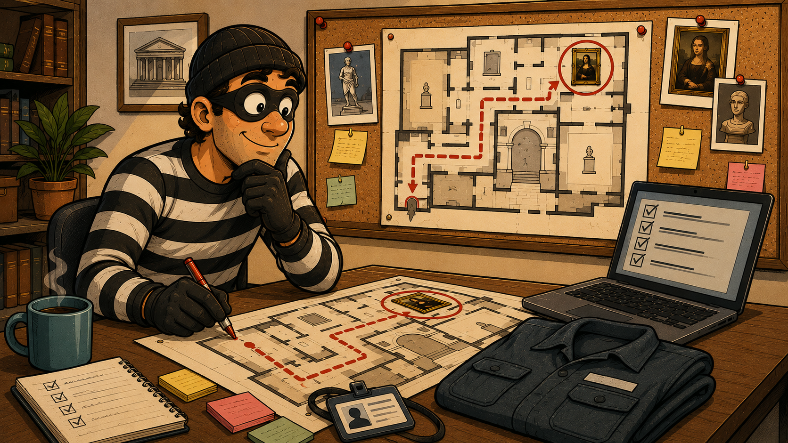
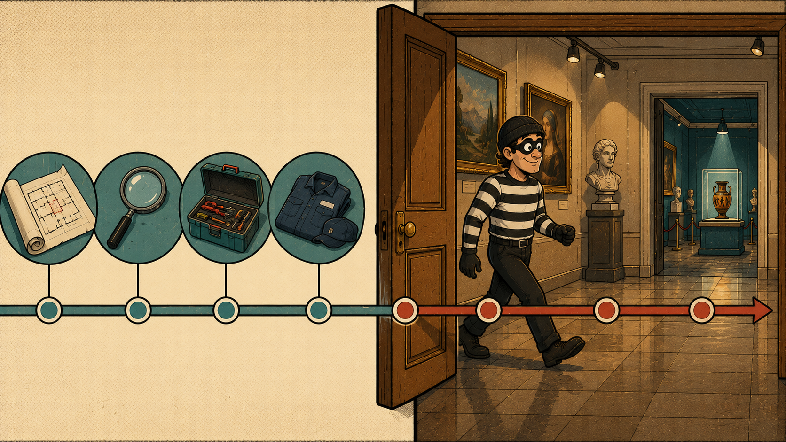
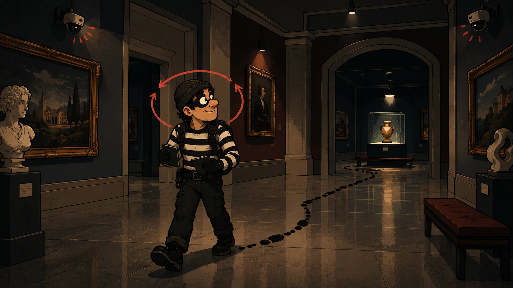

## Introducción

En el [primer artículo](../red-teaming-pensar-como-el-adversario/) de esta serie vimos _qué_ es el Red Teaming; en el [segundo](../que-servicio-de-seguridad-ofensiva-necesitas/), _cuándo_ toca cada servicio. Queda la pregunta que casi nadie ve por dentro: una vez contratado, ¿cómo se hace? ¿Qué pasa entre que se firma el contrato y que aterriza el informe encima de la mesa? Este artículo abre esa caja, y lo hace con los personajes de siempre: el museo con su obra más valiosa, el director que se cree a salvo, el guardia que no mira las cámaras y, sobre todo, el ladrón, uno de los buenos, uno que juega en nuestro equipo. Cada fase de una simulación tiene su reflejo en cómo prepararía y ejecutaría el golpe ese ladrón.

En el fondo, simular a un adversario es reproducir el comportamiento de alguien que va en serio a por ti para medir si tu defensa se entera y reacciona. Su objetivo no es entregar una lista de vulnerabilidades, para eso ya hay otros servicios, sino responder tres preguntas incómodas: ¿lo detectan?, ¿en cuánto tiempo?, ¿saben qué hacer cuando lo detectan? Y lo hace probando las tres patas a la vez, como en el museo: la tecnología (las cámaras, la vitrina), los procesos (la llave colgada en el cuartito) y las personas (el guardia que no mira las pantallas). Un atacante real irá siempre a por la más débil, y rara vez es la tecnología.

Un matiz que conviene fijar desde ya, porque marca todo lo que viene: hablamos de _simulación_, no de _emulación_. Emular es copiar a un adversario concreto y real, reproduciendo paso a paso sus técnicas conocidas. Simular es más abierto: se construye un adversario _plausible_, verosímil para tu organización, sin la camisa de fuerza de calcar a un actor único. Y esa libertad es justo la ventaja, porque permite al equipo adaptarse sobre la marcha, cambiar de técnica cuando una no funciona o cuando la defensa reacciona, igual que haría un atacante de verdad. La emulación sigue un guion; la simulación improvisa dentro de un perfil. Nuestro ladrón no es un ladrón famoso al que imitamos gesto a gesto: es un buen ladrón cualquiera, al que soltamos para ver cómo aguanta el edificio.

Con esto en la cabeza, empieza el trabajo de verdad. Y lo primero, antes de tocar absolutamente nada, es tener clarísimo qué se busca.

## Definir los objetivos: la decisión que más valor mueve

Aquí va una idea que sorprende a mucha gente: el valor de una simulación se decide, en gran parte, antes de que empiece la ejecución. No en el teclado, sino en la reunión donde se define qué se va a poner a prueba. Un ejercicio vale exactamente lo que valen las preguntas que fue diseñado para responder. Y esas preguntas son los objetivos.

Volviendo al museo: darle al ladrón la orden de _"entra y coge lo que puedas"_ suena flexible, pero es la peor forma de empezar. Sin un blanco claro, es el propio ladrón quien decide sobre la marcha qué sala importa, dónde invertir el tiempo y qué cuenta como éxito. Puede salir con un jarrón del vestíbulo y darlo por bueno, mientras la obra que de verdad te quita el sueño sigue colgada sin que nadie la haya tocado. El resultado es un ejercicio lleno de hallazgos técnicamente ciertos que dejan sin responder justo lo que te importaba.

### El problema de "entra y a ver qué pillas"

Un alcance abierto, del tipo _"probad lo que se os ocurra"_, arrastra tres problemas que se repiten una y otra vez:

- **Expectativas descolocadas.** Con el alcance difuso, cada responsable se hace su propia película de qué se estaba probando y nadie se pone de acuerdo al leer los resultados. Un objetivo claro ata el ejercicio a una decisión concreta desde el minuto uno.

- **El entorno se mueve.** Con permiso para explorarlo todo, el equipo invierte días en caminos que dejan de importar cuando el entorno cambia a mitad de ejercicio. Un objetivo acotado concentra el esfuerzo en lo que pesa y es menos probable que cambie.

- **Tiempo gastado decidiendo, no probando.** Sin un blanco definido, media operación se va en decidir dónde invertir el esfuerzo en lugar de probar. Acabas con un informe lleno de observaciones correctas y poca certeza sobre lo que de verdad importaba.

Que quede claro: un buen equipo encontrará hallazgos inesperados por cualquier camino, y eso está muy bien. Pero esos descubrimientos deben complementar el trabajo dirigido por objetivos, no sustituirlo.

### Un solo objetivo primario

De aquí sale una recomendación muy concreta: estructurar el ejercicio en torno a un único **objetivo primario**. Cuando un cliente llega con dos o tres, aparece el mismo problema de antes: el equipo tiene que decidir dónde centrarse, y esa decisión acaba tomándose en el campo en lugar de en la conversación de alcance. Un objetivo primario garantiza evidencia clara y accionable sobre lo que más importa, en vez de medias respuestas repartidas por varias áreas.

Ese objetivo primario no se alcanza de un salto: se llega encadenando pequeños hitos que van abriendo camino hacia él. Y, aparte, se pueden fijar **objetivos secundarios**, de menor valor, que se persiguen si el primario ya está resuelto o si sobra tiempo. La jerarquía queda así en tres alturas: los hitos que llevan al objetivo, el objetivo primario que manda, y los secundarios que suman si dan margen.

Se ve bien con el ajedrez. El **rey** es el objetivo primario, el que decide la partida: en el museo, llevarse la Mona Lisa. No lo alcanzas de golpe, sino moviendo piezas: colarte por el conducto de ventilación, esquivar al vigilante, llegar a la sala. Cada uno de esos movimientos es un hito, un pequeño objetivo que por sí solo no gana nada pero sin el cual no se llega al rey. Y si en el camino puedes además llevarte un jarrón del vestíbulo sin desviarte de tu partida, ese es un objetivo secundario: está bien tenerlo, pero nunca a costa del rey.

### Dos niveles: estratégico y táctico

Los objetivos viven en dos alturas distintas, y conviene no mezclarlas:

- **Objetivos estratégicos.** El _qué_ tiene que lograr el ejercicio, el resultado de negocio que se persigue. Se documentan en el contrato o _statement of work_. Ejemplo: _"determinar si un atacante puede llegar a los datos de tarjetas de los clientes"_.
- **Objetivos tácticos.** El _cómo_, en concreto, va a perseguir el equipo ese resultado: qué se permite, qué no, qué reglas del juego rigen. Se documentan en las reglas de enfrentamiento o _rules of engagement_.

El estratégico dice a qué sala hay que llegar; el táctico fija con qué límites, a qué horas y sin romper qué vitrinas de verdad.

### Qué tienen en común los buenos objetivos

Los objetivos que funcionan comparten cuatro cualidades, y tienen que estar las cuatro a la vez:

- **Específico**: apunta a un activo o resultado concreto y se centra en el _impacto_, no en el método. El error típico es fijar una técnica ("obtener credenciales de administrador de dominio") cuando la pregunta real es si el atacante podría llegar a los datos confidenciales. Amarrar el _cómo_ estrecha las opciones y hace perder caminos que importaban igual.
- **Respondible**: plantea una pregunta que el ejercicio pueda cerrar dentro de las restricciones acordadas. Si es demasiado amplio, no hay forma de saber cuándo se ha conseguido.
- **Accionable**: su respuesta conecta con una decisión que la organización está dispuesta a tomar.
- **Relevante**: refleja un riesgo de negocio real, no un sistema heredado que a nadie le quita el sueño.

La diferencia se ve mejor enfrentando ejemplos flojos y sólidos:

| Objetivo flojo | Objetivo sólido |
|---|---|
| "Obtener credenciales de administrador de dominio" | "Determinar si un atacante con acceso a un puesto de trabajo corporativo podría llegar a los datos confidenciales de clientes" |
| "Evaluar nuestra postura de seguridad" | "Acceder a las bases de datos con datos de tarjetas dentro del entorno de cardholder data" |
| "Probad el chatbot de IA" | "Comprobar si un usuario con acceso estándar a la aplicación podría leer las conversaciones de otros usuarios o ejecutar código en la infraestructura que la sostiene" |

Fíjate en el patrón: el flojo describe una técnica o un deseo vago; el sólido describe un resultado concreto, medible y ligado a algo que duele.

### Por dónde empezar: cuatro familias de objetivos

En la práctica, la mayoría de los objetivos que aportan valor caen en una de estas cuatro categorías:

- **Alcanzabilidad de un activo crítico.** ¿Puede un atacante llegar a un blanco de alto valor? Sistemas de producción, datos confidenciales, control administrativo de tier-zero, la infraestructura que sostiene un sistema de IA.
- **Validación de la detección.** ¿Determinados comportamientos del atacante dispararían una alerta?, ¿en qué punto de la cadena se enteraría el SOC?
- **Prueba de la capacidad de respuesta.** Si se detecta, ¿es capaz el equipo de contener la actividad? ¿Qué revela la respuesta sobre escalado, contención, expulsión y recuperación? Un objetivo pensado así puede pedir, por ejemplo, exfiltrar un volumen grande de datos de un sistema sensible, para medir no solo si se detecta, sino si el equipo responde bien bajo condiciones realistas.
- **Prueba de suposiciones.** ¿Aguanta una creencia de seguridad concreta frente a un atacante real? ¿Funcionan de verdad la segmentación, el acceso privilegiado, el aislamiento de un sistema, los flujos de datos sensibles, tal y como se supone que deberían?

### La prueba del "¿y si lo conseguimos?"

Antes de dar un objetivo por bueno, hay una pregunta que lo filtra casi todo: ¿qué haría tu organización si el ejercicio lo logra?

- _"Priorizaríamos la remediación"_ o _"invertiríamos en detección"_ → buen objetivo.
- _"Sería interesante saberlo"_ → necesita afinarse.
- _"Probablemente no cambiaríamos nada"_ → seguramente no vale la pena perseguirlo.

Esta misma lógica ayuda después: unos objetivos claros hacen que los hallazgos se conviertan en remediación, en ingeniería de detección o en escenarios de práctica, en lugar de acabar como un informe que se archiva y ya.

Y hay un beneficio extra, nada menor: los objetivos claros son mucho más fáciles de contar a la dirección. _"Probamos si un atacante podía llegar a la base de datos de pagos"_ le dice mucho más a un director financiero que _"probamos técnicas de movimiento lateral"_. Uno habla de dinero; el otro, de una tecnicidad que no sabe interpretar.

En el fondo, definir bien los objetivos es comprometer a la organización a decidir _qué necesita aprender_ antes de que empiece el ejercicio. No todo cabe en una sola simulación. La pregunta buena no es _"¿qué podríamos probar?"_, sino _"¿qué es lo que más importa ahora mismo?"_. Ese es el cuadro que hay que robar. Con él fijado, ya podemos hablar de desde dónde empieza el ladrón.

## Desde dónde se empieza: Zero Knowledge vs Assumed Breach

Con el objetivo claro, toca decidir el punto de partida. Ya lo tratamos a fondo en el [primer artículo](../red-teaming-pensar-como-el-adversario/#aproximaciones-zero-knowledge-y-assumed-breach), así que aquí solo el recordatorio y lo que cambia en la ejecución.

- **Zero Knowledge**: el ladrón empieza en la acera, sin plano ni llaves, y tiene que hacerlo todo, desde investigar el edificio hasta conseguir el primer pie dentro.
- **Assumed Breach**: se da por hecho que el atacante ya está dentro (un puesto comprometido, unas credenciales) y el ejercicio arranca ahí.

Para el Assumed Breach viene bien un ejemplo del mundo real. En el documental _Sapo, S.A. Memorias de un ladrón_ (Prime Video), Jon Imanol Sapieha, alias _El Sapo_, cuenta cómo preparó en 2001 el que sería el mayor robo de arte de una colección en España: se llevó del búnker acorazado del ático de Esther Koplowitz obras de Goya, Brueghel y Juan Gris valoradas en más de 30 millones de euros. Lo interesante es _cómo_ lo montó. No forzó una sola cerradura al principio: dedicó tres años a ganarse al vigilante de seguridad. Alquiló un piso al lado, se hizo su amigo y lo fue metiendo en un mundo de lujo (coches, yates, fiestas en Ibiza) hasta tenerlo de su lado. Cuando llegó el día, el punto más blindado del edificio ya estaba comprometido desde dentro: una persona de confianza.

Traducido al mundo ciber, ese vigilante es el empleado o la credencial de confianza que el atacante ya ha comprometido: alguien que hizo clic donde no debía, unas credenciales filtradas, o incluso un trabajador descontento que decide abrir la puerta. Ese factor humano de conseguir a la persona de dentro no se puede simular en un ejercicio, y precisamente por eso existe el Assumed Breach: en vez de reproducir los "tres años" que costó ganarse al vigilante, parte de que el atacante ya lo tiene en el bolsillo y se pregunta lo que de verdad importa: desde esa posición de confianza, ¿hasta dónde puede llegar antes de que alguien lo note?

La diferencia, en términos del recorrido que vamos a ver, es simple: **Zero Knowledge obliga a recorrer entera la fase previa al compromiso; Assumed Breach la comprime y te suelta directamente en la post-explotación**, que es donde se juega la mayoría del valor. Por eso recorreremos el camino completo, el de Zero Knowledge, porque incluye todas las fases; en un Assumed Breach saltaríamos el acceso inicial y aterrizaríamos en la post-explotación. Con eso claro, empieza la preparación.

## Threat Modelling: a qué amenaza nos enfrentamos

Ya sabemos qué cuadro hay que robar y desde dónde arranca el ladrón. Falta una pieza antes de mover un dedo: ¿contra qué tipo de amenaza ponemos a prueba el edificio? No defiende igual un museo frente a un carterista oportunista que frente a una banda que lleva meses estudiándolo. Decidir a qué nos enfrentamos es el trabajo de _threat modelling_, y lo hace el equipo de inteligencia de amenazas (_Threat Intelligence_ o CTI).

Su labor es responder una pregunta: si un museo como este fuera a sufrir un robo de verdad, ¿quién iría a por él y cómo? El CTI mira el sector de la organización, su geografía, su exposición y lo que tiene de valioso, y perfila qué adversarios tendrían motivos reales para atacarla. Una entidad financiera atrae a grupos con motivación económica; una empresa estratégica, a actores patrocinados por estados. La defensa que hay que probar cambia con cada uno.

Y aquí vuelve el matiz que fijamos al principio: estamos haciendo una **simulación**, no una emulación. No se clona gesto a gesto a _un_ actor concreto, sino que se construye un adversario **plausible**, un perfil verosímil inspirado en cómo se comportan los grupos que atacarían a una organización así, con libertad para elegir el camino. Con ese perfil, el equipo recopila el _cómo_: qué técnicas usan de verdad esos grupos, por dónde entran, cómo se mueven, cómo se esconden. Sale de informes de inteligencia y del histórico de varios actores, no de uno solo. El resultado es un catálogo de tácticas, técnicas y procedimientos (TTPs) creíbles: el guion de comportamiento que el equipo ofensivo reproducirá. En el museo sería estudiar cómo operan las bandas que roban arte (entrar de día como mantenimiento, sobornar a alguien de dentro, aprovechar el cambio de turno) sin copiar un atraco concreto.

Para que esto no sea un batiburrillo de notas sueltas, la industria usa un marco común: **MITRE ATT&CK**, una base de conocimiento que cataloga y nombra las tácticas (el _para qué_: acceso inicial, escalado, exfiltración…) y las técnicas (el _cómo_) de adversarios reales. Su valor es poner a todos a hablar el mismo idioma: el CTI, el equipo ofensivo y el defensivo referencian cada técnica con el mismo identificador. Sobre ese marco, herramientas como **ATT&CK Navigator** permiten pintar el mapa de TTPs del perfil elegido, que sirve de brújula para lo que viene y, más adelante, para comparar lo que hizo el ataque con lo que la defensa vio.

La salida de esta fase es un **perfil de amenaza**: quién nos hace de adversario, qué persigue, con qué técnicas y con qué límites. Ese documento guía todo lo que viene, desde qué infraestructura montar hasta cómo se plantea el primer vector de entrada. Y de eso va lo siguiente.

## El mapa del recorrido: PRE-ATT&CK y ATT&CK

Ya tenemos objetivo, punto de partida y perfil de amenaza. A partir de aquí empieza el trabajo de campo, y conviene tener un mapa. Todo lo que hace el equipo ofensivo se puede dividir en dos grandes mitades, y la línea que las separa es un momento muy concreto: cuando se pasa a **ejecutar los vectores de ataque**, es decir, cuando se lanza el ataque de verdad contra la víctima.

- **PRE-ATT&CK**, o fase de pre-compromiso: toda la preparación _previa_ a lanzar el ataque. El ladrón estudiando el museo, consiguiendo el mono de trabajo y fabricando la credencial falsa, todo antes de poner un pie en el edificio.
- **ATT&CK**, o fase de post-compromiso: lo que ocurre _desde_ que se ejecutan los vectores. Entrar, orientarse, moverse, escalar y llegar hasta el cuadro. El ladrón cruzando la puerta y avanzando hacia la sala 3.

Dentro de la fase PRE-ATT&CK, el trabajo avanza por dos vías en paralelo:

- **La línea de análisis**, que va estrechando el foco en tres pasos encadenados: de la **superficie de exposición** (todo lo que la organización enseña al mundo) a la **superficie de ataque** (lo que de ahí es realmente atacable) y de ahí a los **vectores de ataque** (los caminos concretos por los que se intentará entrar).
- **La línea de construcción**, que ocurre a la vez: montar la **infraestructura** desde la que se opera y desarrollar los **artefactos** y métodos de entrega que se van a usar.

Cuando ambas vías convergen, análisis y armamento listos, se pasa a la fase de ataque y se ejecutan los vectores. Esa es la estructura que seguiremos: primero la fase PRE-ATT&CK con sus dos vías, y luego la fase ATT&CK con lo que pasa una vez se lanza el ataque.

> **Un apunte de precisión.** Puede que hayas oído hablar de PRE-ATT&CK como una matriz propia de MITRE. Lo fue: existió como matriz independiente que catalogaba las técnicas de reconocimiento y preparación previas al ataque. En octubre de 2020, con la versión 8 de ATT&CK, MITRE la retiró y trasladó esas técnicas a la matriz principal (_Enterprise_), donde hoy viven como dos tácticas: _Reconnaissance_ (TA0043) y _Resource Development_ (TA0042). Es decir, "PRE-ATT&CK" ya no es una matriz oficial, pero el término sigue siendo comodísimo para nombrar todo lo que pasa antes del compromiso, y por eso lo usamos aquí con ese sentido.

Con el mapa en la cabeza, entramos en la primera mitad: la preparación.

## Fase PRE-ATT&CK: preparar el golpe

Todo lo que viene ahora ocurre sin que la víctima note nada, porque todavía no la hemos tocado. Es la fase más invisible y, a la vez, la que decide buena parte del resultado. Un ladrón que se presenta en el museo sin haber estudiado el edificio dura cinco minutos. Vamos con las dos vías, empezando por la de análisis.

### Vía de análisis (1): la superficie de exposición

El primer paso es mirar a la organización con los ojos de un atacante que aún no sabe nada de ella. ¿Qué enseña al mundo sin darse cuenta? Esto es el **reconocimiento** (en ATT&CK, la táctica _Reconnaissance_), y en un ejercicio Zero Knowledge es por donde se empieza de cero.

Aquí se recopila todo lo que la organización deja ver desde fuera, casi siempre sin tocarla directamente, usando fuentes abiertas (OSINT): dominios y subdominios, rangos de IP, servicios y portales expuestos a internet, tecnologías que usa, nombres y correos de empleados que aparecen en LinkedIn o en filtraciones, documentos con metadatos, repositorios de código olvidados, credenciales que ya andan por ahí de brechas anteriores. Todo suma. El conjunto de todo eso es la **superficie de exposición**: la sombra que la empresa proyecta hacia fuera.

En el museo es la fase de estudiar el edificio desde la acera: cuántas entradas tiene, a qué hora entra el personal de limpieza, quién es el proveedor del aire acondicionado, qué se ve por la ventana. Nadie ha entrado aún; solo se observa.

### Vía de análisis (2): la superficie de ataque

No todo lo que se expone es atacable. El siguiente paso es filtrar esa exposición y quedarse con lo que de verdad ofrece una vía de entrada. De los cien subdominios encontrados, ¿cuáles corren algo vulnerable o mal configurado? De los trescientos correos, ¿cuáles siguen activos y son buenos candidatos para un phishing? De los servicios expuestos, ¿cuáles aceptan autenticación, tienen una versión antigua o una mala configuración aprovechable?

Ese subconjunto, lo que pasa de "está ahí fuera" a "por aquí se podría entrar", es la **superficie de ataque**. Es el vocabulario que ya usamos en el [segundo artículo](../que-servicio-de-seguridad-ofensiva-necesitas/): la superficie de exposición es todo lo que tienes; la de ataque es lo que cede al empujar. En el museo, es tachar de la lista lo blindado y quedarte con la puerta de mantenimiento cuya cerradura lleva meses rota.

### Vía de análisis (3): los vectores de ataque

Con la superficie de ataque acotada, se plantean los **vectores de ataque**: los caminos concretos por los que se intentará conseguir el primer acceso. No es un "a ver qué funciona", sino un puñado de opciones bien pensadas y priorizadas según lo verosímil que sea cada una para el perfil de amenaza que definió inteligencia, y según lo que menos ruido haga.

Un vector puede ser un correo de _spearphishing_ a un grupo concreto de empleados con un adjunto preparado; otro, aprovechar un servicio expuesto con una vulnerabilidad conocida; otro, una aplicación web con una mala configuración; otro, dejar caer un USB en el aparcamiento. Se eligen uno o varios candidatos, se ordenan por probabilidad de éxito y sigilo, y se guardan para la fase de ataque. En el museo son las formas de colarse que baraja el ladrón: entrar de mantenimiento, colarse en el cambio de turno, sobornar a un proveedor. Elige las mejores y descarta el resto.

### Vía de construcción (1): la infraestructura

En paralelo a todo ese análisis, hay que montar el taller desde el que se opera. Un atacante serio no lanza el ataque desde su portátil de casa: levanta una **infraestructura** pensada para funcionar bien y, sobre todo, para no delatarle. Aquí entran conceptos que conviene nombrar aunque sea por encima.

El corazón es el **C2** (_Command and Control_), el servidor desde el que el operador controla las máquinas comprometidas y les manda órdenes. Existen marcos preparados para esto: comerciales como **Cobalt Strike** o de código abierto como **Mythic** o **Sliver**. Pero exponer el C2 directamente a internet es pintarse una diana, así que delante se colocan **redirectores**: servidores intermedios que reciben el tráfico de las víctimas y lo reenvían al C2, de forma que lo que la defensa ve es el redirector y no el servidor real. Se suele separar además la infraestructura de largo plazo (la que mantiene el acceso sigiloso, "a fuego lento") de la de corto plazo (la más ruidosa, para tareas puntuales), para que si cae una no se lleve la otra por delante.

A esto se suman detalles de **OPSEC** (seguridad de las operaciones) que marcan la diferencia entre pasar desapercibido o no: registrar dominios con buena reputación o **categorizarlos** para que parezcan legítimos (una web de recursos humanos, una tienda), usar certificados TLS válidos para cifrar y dar apariencia normal al tráfico, y en general hacer que todo lo que toca la víctima parezca de lo más corriente. En el museo es preparar la furgoneta con el logo del servicio técnico, el uniforme creíble y la documentación que aguante un vistazo. Cuanto mejor el disfraz, más tarde saltan las alarmas.

### Vía de construcción (2): artefactos y métodos de entrega

Con la infraestructura en pie, faltan las armas: los **artefactos** que se van a ejecutar en la máquina de la víctima y la forma de hacérselos llegar.

El artefacto típico es un _payload_ o un _loader_: un fichero que, al ejecutarse, abre el canal de comunicación con el C2 y da al operador el control de esa máquina. El problema es que las víctimas no están indefensas: tienen antivirus y **EDR** vigilando. Por eso buena parte del trabajo aquí es la **evasión**: conseguir que el artefacto no salte. Esto incluye técnicas para esquivar mecanismos de inspección de Windows como **AMSI** (el que revisa scripts en memoria) o **ETW** (el que registra telemetría para el EDR), ofuscar el código, o firmar los binarios para que parezcan de fiar. No hace falta bajar al detalle; basta quedarse con la idea de que un artefacto que funciona en el laboratorio pero salta a la primera en el entorno real no sirve de nada.

Y luego está el **método de entrega** (_delivery_): cómo llega ese artefacto a la víctima. Depende del vector elegido. Si el vector es phishing, será un adjunto o un enlace en un correo creíble; si es el USB del aparcamiento, irá en la memoria; si es un servicio expuesto, se entregará explotando ese servicio. En el museo son las herramientas del ladrón y la forma de meterlas: los guantes, la ganzúa y el carrito de limpieza donde esconderlo todo al entrar.

Cuando las dos vías están listas, análisis con sus vectores priorizados y construcción con la infraestructura y los artefactos a punto, la preparación termina. Todo lo anterior se hizo sin que la organización se enterara de nada. Eso está a punto de cambiar.

## Fase ATT&CK: ejecutar el golpe

Aquí es donde la simulación toca a la víctima por primera vez y, con ella, donde empieza a medirse de verdad la defensa. Todo lo anterior fue preparación silenciosa; a partir de ahora cada acción deja un rastro que el Blue Team podría ver. Esta es la mitad que aporta la mayoría del valor del ejercicio.

### Acceso inicial: cruzar la puerta

Se ejecutan los vectores planteados en la fase anterior, por orden de prioridad, hasta que uno funciona y da el primer punto de apoyo dentro de la organización. Es el **acceso inicial** (en ATT&CK, _Initial Access_): el empleado que abre el adjunto del correo y ejecuta el artefacto, el servicio expuesto que cede, el USB que alguien enchufa. En ese instante, el C2 recibe la primera conexión desde dentro. El ladrón ya ha cruzado la puerta de mantenimiento vestido de operario.

Y aquí se mide algo ya, aunque el ejercicio no haya hecho más que empezar: ¿saltó alguna alarma cuando el artefacto se ejecutó?, ¿el EDR dijo algo?, ¿alguien en el SOC vio ese correo raro o esa conexión saliente extraña? El acceso inicial no es solo un logro del atacante, es la primera lectura del sensor defensivo.

### Post-explotación: el bucle dentro de la casa

Conseguir el primer acceso no es llegar al cuadro, es entrar por la puerta de servicio a un edificio enorme y a oscuras. Lo que viene, la **post-explotación**, es la parte más larga y la más delicada, y conviene entenderla bien: no es una lista de pasos que se recorre en línea recta, es un **bucle** que se repite una y otra vez hasta llegar al objetivo.

El bucle es más o menos así:

- **Reconocimiento de situación** (_situational awareness_). Nada más caer en una máquina, lo primero es orientarse: ¿dónde estoy?, ¿qué máquina es esta?, ¿quién soy en ella, un usuario normal o algo más?, ¿en qué dominio está?, ¿qué hay alrededor, qué otras máquinas y servicios veo?, ¿hay un EDR mirándome? Igual que el ladrón, recién entrado, se queda quieto un momento y mira: en qué sala está, dónde están las cámaras, por dónde se sigue.
- **Actuar sobre lo que se ve.** Con ese mapa mental, se decide el siguiente movimiento, que casi siempre es una de estas cosas:
  - **Persistir** (_Persistence_): lo primero al caer en una máquina que interesa es asegurar la vuelta. Dejar una forma de volver a entrar si te echan o si se reinicia, para no arriesgarte a perder el acceso y tener que empezar de cero.
  - **Escalar privilegios** (_Privilege Escalation_): pasar de usuario de a pie a administrador de la máquina, porque muchas puertas de dentro solo se abren con más permisos.
  - **Robar credenciales** (_Credential Access_): hacerse con usuarios y contraseñas, tokens o tickets que permitan moverse como si fueras alguien legítimo.
  - **Moverse lateralmente** (_Lateral Movement_): saltar de esa máquina a otra más interesante, acercándose al objetivo. De la sala de mantenimiento al pasillo, del pasillo a la sala 3.
  - Todo ello **evadiendo la defensa** (_Defense Evasion_) en cada paso, cuidando el OPSEC para hacer el menor ruido posible.
- **Volver a orientarse.** Cada acción cambia la situación: ahora eres administrador, o estás en una máquina nueva, o tienes credenciales de otro usuario. Así que se vuelve a evaluar el entorno y se repite el bucle. Reconocer, actuar, reconocer, actuar, un paso más cerca cada vuelta.

Ese ciclo se repite tantas veces como haga falta, siempre con una brújula: el objetivo definido al principio. No se toca lo que no acerca al cuadro, porque cada acción de más es ruido y una oportunidad de que la defensa te pille.

### Cumplimiento de objetivos: llegar al cuadro

El bucle termina cuando se alcanza lo que se vino a buscar: el objetivo primario que se fijó en el contrato. En nuestro caso, llegar hasta el sistema que ordena las transferencias. El ladrón está por fin delante de la vitrina de la sala 3, con el cuadro al alcance de la mano.

Pero, y esto es clave, llegar hasta el cuadro no es el final del ejercicio. Tener acceso al sistema objetivo es haber demostrado que _se puede_ llegar; falta demostrar qué significa eso para la organización. Y ese es justo el siguiente paso.

## Demostrar el impacto: del "se puede" al "esto cuesta"

Hay una distancia enorme entre decir _"conseguimos acceso al sistema de transferencias"_ y hacer entender lo que eso implica. Lo primero es una frase técnica que a un directivo le suena a ruido; lo segundo es lo que le quita el sueño. El trabajo de esta fase es cruzar esa distancia: traducir el acceso conseguido en una **consecuencia de negocio** tangible.

Es la idea del _IS_ frente al _SHOULD-BE_ que vimos en el [primer artículo](../red-teaming-pensar-como-el-adversario/). La organización cree que su sistema crítico está a salvo (el _should-be_); el ejercicio demuestra la realidad (el _is_). Y esa realidad no se demuestra con un pantallazo de un acceso concedido, sino enseñando qué se podría hacer con él. Según el objetivo, eso toma formas distintas:

- Si el objetivo eran **datos**, se demuestra que se pueden exfiltrar: no llevándose de verdad la base de datos de clientes, sino probando de forma controlada que el camino de salida existe y funciona, por ejemplo sacando un fichero señuelo o una muestra acotada y pactada.
- Si el objetivo era un **sistema de negocio**, como el de las transferencias de nuestro banco, se demuestra el alcance del control conseguido sin llegar a causar daño: enseñar que se podría ordenar una transferencia, no ordenarla; que se podría manipular un registro, no manipularlo.
- Si el escenario es de **resiliencia**, como una simulación de ransomware, se demuestra la capacidad de cifrado sobre un conjunto limitado y acordado, para medir el impacto real sin tumbar la operación.

La palabra que gobierna todo esto es **controlado**. El objetivo es _probar_ el impacto, no _provocarlo_. Aquí es donde las reglas de enfrentamiento que se pactaron al principio valen su peso en oro: definen hasta dónde se puede llegar para que la demostración sea creíble sin poner en riesgo el negocio de verdad. El buen ladrón del ejercicio saca el cuadro de la vitrina, lo enseña a la cámara para dejar constancia de que pudo, y lo vuelve a colgar. No se lo lleva a casa.

Demostrar el impacto es lo que convierte un hallazgo técnico en un argumento de negocio. _"Un atacante con un correo bien hecho podría, en X días, llegar a ordenar transferencias desde vuestro core"_ mueve presupuestos y decisiones de una forma que _"encontramos una ruta de movimiento lateral hasta el servidor SAP"_ no consigue jamás. Y ese argumento es, precisamente, lo que hay que dejar por escrito.

## El informe: donde el ejercicio se convierte en valor

Todo lo anterior no vale nada si acaba en un informe que nadie sabe leer o que se archiva sin más. El entregable es el producto real del ejercicio: es lo único que queda cuando el equipo ofensivo se va. Un informe que solo lista comandos, CVEs y capturas de pantalla ha fracasado, por muy brillante que fuera la parte técnica. El buen informe cuenta una historia y termina en decisiones.

Un informe que aporta valor suele apoyarse en cuatro piezas:

- **El relato del incidente, paso a paso.** La narración de cómo se llegó desde el primer correo hasta el sistema de transferencias: qué se hizo, en qué orden, aprovechando qué. No por presumir, sino porque ese relato es un mapa. Enseña la cadena completa y, sobre todo, deja ver en qué eslabones se podría haber cortado. Es el equivalente a reconstruir el robo del museo minuto a minuto: por dónde entró, qué puerta estaba abierta, quién no miró.
- **Los hallazgos, priorizados y por causa raíz.** No una lista plana de fallos, sino los problemas ordenados por gravedad y, cuando es posible, apuntando a la **causa raíz** en lugar de al síntoma. Diez alertas que no saltaron pueden tener detrás un único fallo de configuración; atacar la raíz arregla las diez de golpe. Un buen informe distingue el problema de fondo del arañazo superficial.
- **La traducción a riesgo de negocio.** Cada hallazgo importante acompañado de qué significa en términos que la dirección entienda: no _"Kerberos mal configurado"_, sino _"esto es lo que permitió llegar al sistema de pagos, y esto es lo que costaría si pasara de verdad"_.
- **Recomendaciones ordenadas.** Qué cambiar, en qué orden y por qué. Si al cerrar el documento la organización no sabe exactamente qué hacer el lunes por la mañana, el informe no ha terminado su trabajo.

Y hay algo que este informe tiene y que el de un pentest no: mide a la **defensa**. Como el ejercicio se hizo sin avisar al Blue Team, el informe puede contar el otro lado de la historia. ¿Se detectó algo?, ¿qué exactamente y qué pasó desapercibido?, ¿cuánto se tardó en verlo?, ¿cuánto en reaccionar? Esos tiempos, cuánto tardas en detectar y cuánto en responder, valen más que cualquier lista de vulnerabilidades, porque son los que de verdad cuentan el día del incidente real.

Por eso el informe suele hablar dos idiomas a la vez, para dos públicos distintos. Para el **equipo técnico y el Blue Team**, el detalle: la cadena, las técnicas, qué regla de detección faltó, qué configuración cambiar. Para la **dirección**, el resumen ejecutivo: qué se demostró, qué riesgo real supone para el negocio y dónde conviene invertir. El mismo ejercicio, contado a dos alturas.

Comparar lo que hizo el equipo ofensivo con lo que la defensa fue capaz de ver, aquella lista de TTPs que se mapeó con ATT&CK al principio, es exactamente el terreno del **Purple Team** que presentamos en el [primer artículo](../red-teaming-pensar-como-el-adversario/): poner una al lado de otra las acciones ejecutadas y las detectadas, y usar los huecos entre ambas como mapa de los puntos ciegos. Ahí es donde el informe deja de ser un veredicto y se convierte en un plan de mejora.

## Conclusiones

Hemos abierto la caja y recorrido una simulación de adversarios de principio a fin: de fijar el objetivo a perfilar la amenaza, de preparar el golpe en la sombra a ejecutarlo, de llegar al cuadro a demostrar lo que costaría de verdad y dejarlo todo por escrito. Si algo debería quedar claro después de todo el recorrido, son tres cosas.

- **El valor se decide antes de tocar un teclado.** La parte que más determina si un ejercicio sirve para algo no es lo vistosa que sea la intrusión, sino lo bien definido que esté el objetivo. Un blanco claro convierte la simulación en una respuesta a una pregunta que le importa al negocio; un _"entrad y a ver qué pilláis"_ la convierte en un montón de hallazgos sueltos que nadie sabe priorizar. Decide primero qué necesitas aprender.

- **La mayor parte del trabajo no se ve.** Lo que la gente imagina de un Red Team, alguien tecleando hasta que algo peta, es apenas la punta. Debajo hay perfilado de amenaza, infraestructura montada con cuidado, artefactos preparados para no saltar, vectores pensados y priorizados. Como el ladrón que dedica tres años a ganarse al vigilante, el grueso del golpe ocurre antes del golpe. Esa preparación silenciosa es la que separa un ejercicio que enseña algo de un grupo de gente probando cosas.

- **El ejercicio es el medio, no el fin.** Llegar al objetivo no es ganar, y el informe no es un trofeo. Todo esto vale por lo que la organización hace con ello el lunes por la mañana: qué arregla, qué detección construye, qué decide invertir. Una simulación no es una foto del estado de tu seguridad, es el empujón que la hace madurar. Y como toda foto, caduca: la seguridad no es un estado al que se llega, sino algo que se mantiene ejercicio tras ejercicio.

Cerramos con el ladrón delante de la vitrina, enseñando el cuadro a la cámara antes de volver a colgarlo. No se lo lleva. Deja, en su lugar, un mapa de por dónde entró, qué puertas encontró abiertas y quién no estaba mirando. Ese mapa vale mucho más que el cuadro, porque es lo que hace que, la próxima vez, el que entre por el conducto del aire no salga saludando.

Nos queda un cabo suelto que merece su propio artículo: qué pasa cuando el ejercicio deja de ser una foto aislada y se convierte en un programa continuo, con el Purple Team como motor y los servicios especializados afinando cada rincón. Pero eso será otro día.

## Referencias

1. SpecterOps — _How to Set Red Team Objectives That Produce Value_ (7 jul 2026): [specterops.io](https://specterops.io/blog/2026/07/07/how-to-set-red-team-objectives-that-produce-value/). (Base del apartado de definición de objetivos: cualidades de un buen objetivo, objetivo primario único, niveles estratégico y táctico, y la prueba del "¿y si lo conseguimos?".)

2. _Sapo, S.A. Memorias de un ladrón_ — serie documental (Prime Video, 2022), sobre Jon Imanol Sapieha, alias _El Sapo_, y el robo de la colección de arte de Esther Koplowitz (Madrid, 2001). Caso real usado como analogía del planteamiento Assumed Breach: ganarse durante años la confianza de una persona de dentro para aprovechar esa posición.

3. MITRE — _ATT&CK_: [attack.mitre.org](https://attack.mitre.org/). Base de conocimiento de tácticas, técnicas y procedimientos (TTPs) de adversarios reales, usada como lenguaje común para modelar la amenaza y mapear el ejercicio. Herramienta de mapeo: _ATT&CK Navigator_.

5. Artículos previos de esta serie: [Red Teaming: pensar como el adversario](../red-teaming-pensar-como-el-adversario/) (qué es, emulación vs simulación, Zero Knowledge vs Assumed Breach) y [¿Qué servicio de seguridad ofensiva necesitas?](../que-servicio-de-seguridad-ofensiva-necesitas/) (escalera de madurez).
