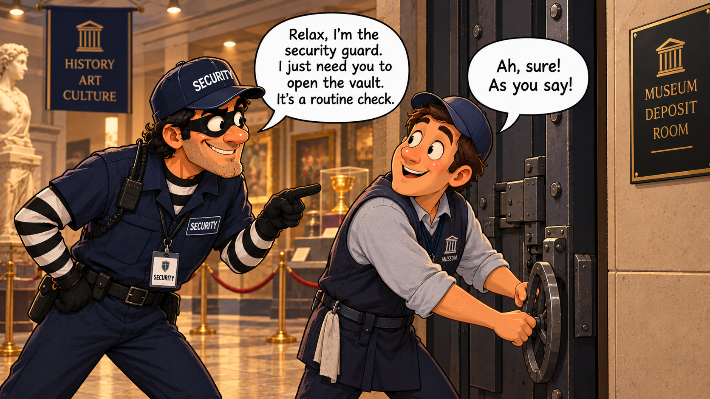

## Introduction

ClickFix is a social engineering technique where a web page copies a command to the victim's clipboard and walks them through executing it in the Run dialog (Win+R, Ctrl+V, Enter). There is no exploit, no malicious attachment: the user themselves executes the initial access. The command, usually a PowerShell or `cmd` one-liner, downloads and launches the first stage of the chain.

The reason it works so well is simple: the command is not a downloaded file, so defences that rely on Mark of the Web have nothing to evaluate. SmartScreen, Protected View, the macro block: none of them fire because the command is born directly in the Run dialog, with no MotW, no Internet zone tag and no reputation. In Microsoft's *Digital Defense Report 2025* it was the most observed initial-access vector of the year. ESET measured a 517% increase in detections in just six months. And it is used by actors across the whole spectrum, from cybercrime gangs to APTs from North Korea, Iran and Russia.

In this article we take apart a complete chain that we built and executed ourselves: from the fake ClickFix captcha to AsyncRAT. Five stages that break the parent-child relationship twice and decouple the final payload, a *polyglot* PDF whose ZIP is decoded in memory, and a `pythonw.exe` that loads AsyncRAT as a .NET assembly in memory.

## State of the art of social engineering

Every delivery vector of the last decade relies on the same thing and falls by the same thing: Mark of the Web (MotW), the tag Windows puts on every downloaded file. Technically it is an alternate data stream (`Zone.Identifier`) that Windows attaches to the file, recording which zone it came from. That value, the `ZoneId`, is what determines how much Windows trusts the file, and it is exactly what SmartScreen, Protected View and the Office macro block read:

| ZoneId | Zone | Behavior |
|:------:|------|----------|
| `0` | Local machine | Files created on the machine itself, not from anywhere. No warnings. |
| `1` | Local intranet | Files from a domain SMB share or similar. Few restrictions. |
| `2` | Trusted sites | URLs explicitly added to the trusted sites zone. Few restrictions. |
| `3` | Internet | Default value for anything downloaded from the Internet. SmartScreen and Protected View kick in here. |
| `4` | Restricted sites | URLs in the restricted sites zone. Severe restrictions. |

With that clear, reviewing the map of vectors and countermeasures reveals the ClickFix play.

| Vector | How it works | How it is blocked |
|--------|-------------|-------------------|
| Office macros | Word or Excel document with a VBA macro the user enables with a click. | Protected View (opens it isolated and read-only) and the default macro block on files with MotW (Office, 2022), no longer with a convenient "Enable". |
| Containers (ISO, VHD, password ZIP) | Hide the payload inside an image or archive whose contents did not inherit MotW when mounted or extracted; the `.lnk` or script inside ran without controls. | Microsoft propagates MotW to the contents of images and archives. |
| WebDAV and `search-ms` | Open remote files in Explorer making them look local and without an Internet mark. | Patches for specific cases, such as Copy2Pwn (CVE-2024-38213), in June 2024. |
| HTML smuggling | Reassembles the file inside the browser with JavaScript so the mail gateway only sees HTML. | The file that lands on disk still carries MotW; SmartScreen checks it by reputation. |

The pattern is obvious: Protected View, macro block, SmartScreen and the propagation patches all revolve around a downloaded file and its MotW. ClickFix breaks the premise: it delivers no file. The command is typed by the user into the Run dialog, so there is no download, no MotW and nothing for those controls to inspect. It is not just another vector on the list, it is removing the defense's anchor point.

## Anatomy of a ClickFix kill-chain

With the why clear, it is time to see what a ClickFix kill-chain looks like end to end. And the first thing, before the command, is how the lure reaches the victim. Reports from recent months split that initial access into a few vectors, combining where the lure is hosted with what it impersonates. We review them and close with the one we will simulate ourselves.

### Compromised websites

This is the most common vector by far, and the one that delivers the widest reach with the least effort. The attacker does not set up their own site: they compromise legitimate ones (vulnerable WordPress plugins, stolen credentials) and inject a small JavaScript loader. That loader does not fire the lure at everyone; it first fingerprints the visitor (geolocation, browser, whether it looks like a bot or a researcher) and only overlays the fake page, a CAPTCHA or a "verify you're human", on targets that fit. This is the model behind ClearFake and web-inject clusters like KongTuke, which Trend Micro observed across thousands of compromised WordPress sites.

The most interesting variant is the one Filescan analyzed: instead of hardcoding the next server's address in the JavaScript, it reads it from a smart contract on a public blockchain (EtherHiding). The contract is a fixed pointer anyone can read but only the attacker can update, so taking down the domains does not kill the configuration, it is enough to point the contract at a new one. Elastic documented another chain on legitimate sites that ended up delivering a custom RAT, MIMICRAT.

<svg viewBox="0 0 778 80" role="img" aria-labelledby="v1-t v1-d" style="display:block;min-width:560px;width:100%;height:auto;font-family:ui-monospace,SFMono-Regular,Menlo,monospace;">
<title id="v1-t">Execution: compromised website</title>
<desc id="v1-d">A visitor to a legitimate site receives an injected JavaScript that overlays the ClickFix lure and ends up executing the command.</desc>
<defs><marker id="v1a" viewBox="0 0 10 10" refX="8" refY="5" markerWidth="7" markerHeight="7" orient="auto-start-reverse"><path d="M0,0 L10,5 L0,10 z" fill="var(--accent,#7aa2f7)"/></marker></defs>
<rect x="10" y="18" width="170" height="44" rx="9" fill="var(--entry,#16181d)" stroke="var(--border,#2a2e37)"/>
<text x="95" y="45" text-anchor="middle" font-size="13" font-weight="700" fill="var(--primary,#e6e8ea)">Legitimate site</text>
<rect x="206" y="18" width="170" height="44" rx="9" fill="var(--entry,#16181d)" stroke="var(--border,#2a2e37)"/>
<text x="291" y="45" text-anchor="middle" font-size="13" font-weight="700" fill="var(--primary,#e6e8ea)">Injected JS</text>
<rect x="402" y="18" width="170" height="44" rx="9" fill="var(--entry,#16181d)" stroke="var(--border,#2a2e37)"/>
<text x="487" y="45" text-anchor="middle" font-size="13" font-weight="700" fill="var(--primary,#e6e8ea)">ClickFix overlay</text>
<rect x="598" y="18" width="170" height="44" rx="9" fill="var(--entry,#16181d)" stroke="var(--accent,#7aa2f7)" stroke-width="1.8"/>
<text x="683" y="45" text-anchor="middle" font-size="13" font-weight="700" fill="var(--primary,#e6e8ea)">User executes</text>
<line x1="180" y1="40" x2="204" y2="40" stroke="var(--accent,#7aa2f7)" stroke-width="2.2" marker-end="url(#v1a)"/>
<line x1="376" y1="40" x2="400" y2="40" stroke="var(--accent,#7aa2f7)" stroke-width="2.2" marker-end="url(#v1a)"/>
<line x1="572" y1="40" x2="596" y2="40" stroke="var(--accent,#7aa2f7)" stroke-width="2.2" marker-end="url(#v1a)"/>
</svg>

### Malvertising and SEO poisoning

If the attacker does not want to wait for the victim to visit a compromised site, they attract them. Malvertising buys ads, often for searches around popular software or AI tools, and SEO poisoning manipulates rankings to slip a malicious result near the top. The victim, who was looking to download something legitimate, clicks the ad or the top result and lands on an attacker-controlled domain that, instead of the download, shows them the fake CAPTCHA. This is how the CORNFLAKE.V3 chain described by Mandiant starts, and the same pattern, starting from ads and poisoned search results, appears in the ACR Stealer campaigns analyzed by Microsoft. It is a particularly effective vector because the victim arrives with their guard down: they are the ones who searched.

<svg viewBox="0 0 778 80" role="img" aria-labelledby="v2-t v2-d" style="display:block;min-width:560px;width:100%;height:auto;font-family:ui-monospace,SFMono-Regular,Menlo,monospace;">
<title id="v2-t">Execution: malvertising and SEO poisoning</title>
<desc id="v2-d">The victim searches for software, clicks a poisoned ad or result, lands on a domain with the ClickFix lure and executes the command.</desc>
<defs><marker id="v2a" viewBox="0 0 10 10" refX="8" refY="5" markerWidth="7" markerHeight="7" orient="auto-start-reverse"><path d="M0,0 L10,5 L0,10 z" fill="var(--accent,#7aa2f7)"/></marker></defs>
<rect x="10" y="18" width="170" height="44" rx="9" fill="var(--entry,#16181d)" stroke="var(--border,#2a2e37)"/>
<text x="95" y="45" text-anchor="middle" font-size="12.5" font-weight="700" fill="var(--primary,#e6e8ea)">Search / ad</text>
<rect x="206" y="18" width="170" height="44" rx="9" fill="var(--entry,#16181d)" stroke="var(--border,#2a2e37)"/>
<text x="291" y="45" text-anchor="middle" font-size="12.5" font-weight="700" fill="var(--primary,#e6e8ea)">Poisoned result</text>
<rect x="402" y="18" width="170" height="44" rx="9" fill="var(--entry,#16181d)" stroke="var(--border,#2a2e37)"/>
<text x="487" y="45" text-anchor="middle" font-size="13" font-weight="700" fill="var(--primary,#e6e8ea)">ClickFix lure</text>
<rect x="598" y="18" width="170" height="44" rx="9" fill="var(--entry,#16181d)" stroke="var(--accent,#7aa2f7)" stroke-width="1.8"/>
<text x="683" y="45" text-anchor="middle" font-size="13" font-weight="700" fill="var(--primary,#e6e8ea)">User executes</text>
<line x1="180" y1="40" x2="204" y2="40" stroke="var(--accent,#7aa2f7)" stroke-width="2.2" marker-end="url(#v2a)"/>
<line x1="376" y1="40" x2="400" y2="40" stroke="var(--accent,#7aa2f7)" stroke-width="2.2" marker-end="url(#v2a)"/>
<line x1="572" y1="40" x2="596" y2="40" stroke="var(--accent,#7aa2f7)" stroke-width="2.2" marker-end="url(#v2a)"/>
</svg>

### Phishing email

The classic is still in the mix, although here the email does not carry the payload: it only carries the hook that ends at the ClickFix page. The body contains a link, or a lightweight attachment (an HTML, a PDF, a ZIP) that redirects to the lure, so what travels through email is harmless and the filters have no malicious file to analyze. Its advantage is targeting: the attacker chooses language, industry and topic (an invoice, a tax notice, an HR message). Microsoft documented Storm-0426 sending thousands of emails targeting users in Germany to ultimately deliver MintsLoader.

<svg viewBox="0 0 778 80" role="img" aria-labelledby="v3-t v3-d" style="display:block;min-width:560px;width:100%;height:auto;font-family:ui-monospace,SFMono-Regular,Menlo,monospace;">
<title id="v3-t">Execution: phishing email</title>
<desc id="v3-d">An email with a link or lightweight attachment redirects to the ClickFix page, where the user executes the command.</desc>
<defs><marker id="v3a" viewBox="0 0 10 10" refX="8" refY="5" markerWidth="7" markerHeight="7" orient="auto-start-reverse"><path d="M0,0 L10,5 L0,10 z" fill="var(--accent,#7aa2f7)"/></marker></defs>
<rect x="10" y="18" width="170" height="44" rx="9" fill="var(--entry,#16181d)" stroke="var(--border,#2a2e37)"/>
<text x="95" y="45" text-anchor="middle" font-size="13" font-weight="700" fill="var(--primary,#e6e8ea)">Email</text>
<rect x="206" y="18" width="170" height="44" rx="9" fill="var(--entry,#16181d)" stroke="var(--border,#2a2e37)"/>
<text x="291" y="45" text-anchor="middle" font-size="13" font-weight="700" fill="var(--primary,#e6e8ea)">Link / attachment</text>
<rect x="402" y="18" width="170" height="44" rx="9" fill="var(--entry,#16181d)" stroke="var(--border,#2a2e37)"/>
<text x="487" y="45" text-anchor="middle" font-size="13" font-weight="700" fill="var(--primary,#e6e8ea)">ClickFix page</text>
<rect x="598" y="18" width="170" height="44" rx="9" fill="var(--entry,#16181d)" stroke="var(--accent,#7aa2f7)" stroke-width="1.8"/>
<text x="683" y="45" text-anchor="middle" font-size="13" font-weight="700" fill="var(--primary,#e6e8ea)">User executes</text>
<line x1="180" y1="40" x2="204" y2="40" stroke="var(--accent,#7aa2f7)" stroke-width="2.2" marker-end="url(#v3a)"/>
<line x1="376" y1="40" x2="400" y2="40" stroke="var(--accent,#7aa2f7)" stroke-width="2.2" marker-end="url(#v3a)"/>
<line x1="572" y1="40" x2="596" y2="40" stroke="var(--accent,#7aa2f7)" stroke-width="2.2" marker-end="url(#v3a)"/>
</svg>

### Brand and service impersonation

This is less of a delivery channel and more the deception layer that sits on top of the others: what the lure disguises itself as to make the victim comply. It almost always mimics something the victim expects to see, a "verify you're human" check (reCAPTCHA, Cloudflare Turnstile), an "update your browser" prompt, or a step to join a meeting. SentinelOne grouped it under the idea of "verification fatigue": we are so used to passing CAPTCHAs that we follow the instructions without thinking. And when the target is specific, the disguise gets sharper, with lures imitating AI brands or, as Moonlock documented, fake venture capital firms targeting crypto talent. The common denominator is that initial access no longer depends on a flaw or an attachment: it depends on bringing the victim to a page and having that page convince them to open Run and paste the command.

<svg viewBox="0 0 778 80" role="img" aria-labelledby="v4-t v4-d" style="display:block;min-width:560px;width:100%;height:auto;font-family:ui-monospace,SFMono-Regular,Menlo,monospace;">
<title id="v4-t">Execution: brand and service impersonation</title>
<desc id="v4-d">The lure impersonates an expected brand or service, shows a fake verification with a Win+R instruction and the victim executes the command.</desc>
<defs><marker id="v4a" viewBox="0 0 10 10" refX="8" refY="5" markerWidth="7" markerHeight="7" orient="auto-start-reverse"><path d="M0,0 L10,5 L0,10 z" fill="var(--accent,#7aa2f7)"/></marker></defs>
<rect x="10" y="18" width="170" height="44" rx="9" fill="var(--entry,#16181d)" stroke="var(--border,#2a2e37)"/>
<text x="95" y="45" text-anchor="middle" font-size="13" font-weight="700" fill="var(--primary,#e6e8ea)">Impersonated brand</text>
<rect x="206" y="18" width="170" height="44" rx="9" fill="var(--entry,#16181d)" stroke="var(--border,#2a2e37)"/>
<text x="291" y="45" text-anchor="middle" font-size="13" font-weight="700" fill="var(--primary,#e6e8ea)">Fake verification</text>
<rect x="402" y="18" width="170" height="44" rx="9" fill="var(--entry,#16181d)" stroke="var(--border,#2a2e37)"/>
<text x="487" y="45" text-anchor="middle" font-size="13" font-weight="700" fill="var(--primary,#e6e8ea)">Win+R instruction</text>
<rect x="598" y="18" width="170" height="44" rx="9" fill="var(--entry,#16181d)" stroke="var(--accent,#7aa2f7)" stroke-width="1.8"/>
<text x="683" y="45" text-anchor="middle" font-size="13" font-weight="700" fill="var(--primary,#e6e8ea)">User executes</text>
<line x1="180" y1="40" x2="204" y2="40" stroke="var(--accent,#7aa2f7)" stroke-width="2.2" marker-end="url(#v4a)"/>
<line x1="376" y1="40" x2="400" y2="40" stroke="var(--accent,#7aa2f7)" stroke-width="2.2" marker-end="url(#v4a)"/>
<line x1="572" y1="40" x2="596" y2="40" stroke="var(--accent,#7aa2f7)" stroke-width="2.2" marker-end="url(#v4a)"/>
</svg>

## Emulating an adversary

With the landscape clear, it is time to build and execute our own chain. The simulation uses ClickFix as the lure, built on top of a fake HR portal with a Cloudflare verification. Two Cloudflare tunnels support the entire operation: one serves the lure website and the first stage, and the other exposes a WebDAV server with the remaining stages and artefacts.

The chain progresses through five stages (0 through 4). Before diving into each one, here is the full journey at a glance:

| Stage | Name | What it does |
|:-----:|------|--------------|
| 0 | Initial access | ClickFix copies a command to the clipboard and the victim runs it via Win+R; `wt.exe` launches `curl` and `cscript` |
| 1 | W, *spawner* | Breaks the process tree with a WMI hop |
| 2 | D, *downloader* | Brings the artefacts to disk from the WebDAV |
| 3 | X, deployment | Decodes the *polyglot* PDF in memory and launches the payload with a second parentage break |
| 4 | Payload | `pythonw.exe` loads AsyncRAT as a .NET assembly in memory |

Two of those hops are true parentage breaks: the next process is born under a different parent (WMI in Stage 1, *ShellWindows* COM in Stage 3) and the EDR's telemetry loses the thread. The third, the hop to the payload, is not: it is *process orphaning* with `start`, where the process keeps its parent's PID but survives its exit. The difference matters, and we will come back to it at the end.

### Infrastructure: two Cloudflare tunnels

The entire operation rests on two Cloudflare tunnels that expose local services to the internet without opening ports or revealing the operator's IP. Traffic exits through a trusted domain (Cloudflare), which helps bypass reputation filters.

| Tunnel | Type | Purpose |
|--------|------|---------|
| Tunnel 1 | Web | Fake HR portal + ClickFix page + first stage |
| Tunnel 2 | WebDAV | JScript stages, artefacts, and signalling |

The first tunnel serves the lure website: an HR portal with a fake Cloudflare verification. It also serves the first stage (`W`) over HTTPS, which eliminates the dependency on the WebClient service during the initial phase. The second exposes a WebDAV server that hosts the remaining stages, the ZIP with the payload, and the `/update` endpoint that the lure uses to know when the chain has progressed.

<svg viewBox="0 0 820 412" role="img" aria-labelledby="net-t-en net-d-en" style="display:block;min-width:620px;width:100%;height:auto;font-family:ui-monospace,SFMono-Regular,Menlo,monospace;">
<title id="net-t-en">Connection diagram</title>
<desc id="net-d-en">Sequence diagram with four actors: Victim, Cloudflare, Attacker and Team Server. Seven numbered messages cross Cloudflare through tunnel 1 or 2 to the attacker's servers; an eighth, AsyncRAT's C2 connection, goes directly over TCP from pythonw.exe to the Team Server without passing through Cloudflare.</desc>
<defs>
  <marker id="naT1e" viewBox="0 0 10 10" refX="8" refY="5" markerWidth="7" markerHeight="7" orient="auto-start-reverse"><path d="M0,0 L10,5 L0,10 z" fill="var(--accent,#7aa2f7)"/></marker>
  <marker id="naT2e" viewBox="0 0 10 10" refX="8" refY="5" markerWidth="7" markerHeight="7" orient="auto-start-reverse"><path d="M0,0 L10,5 L0,10 z" fill="#bb9af7"/></marker>
  <marker id="naC2e" viewBox="0 0 10 10" refX="8" refY="5" markerWidth="7" markerHeight="7" orient="auto-start-reverse"><path d="M0,0 L10,5 L0,10 z" fill="#f7768e"/></marker>
</defs>
<!-- Lifelines -->
<rect x="382" y="72" width="56" height="250" fill="#F6A623" opacity="0.08"/>
<line x1="120" y1="72" x2="120" y2="356" stroke="var(--border,#2a2e37)" stroke-width="1" stroke-dasharray="4 4"/>
<line x1="410" y1="72" x2="410" y2="322" stroke="#F6A623" stroke-width="1" stroke-dasharray="4 4" opacity="0.6"/>
<line x1="700" y1="72" x2="700" y2="322" stroke="var(--border,#2a2e37)" stroke-width="1" stroke-dasharray="4 4"/>
<!-- Headers -->
<rect x="40" y="8" width="160" height="64" rx="10" fill="var(--entry,#16181d)" stroke="var(--border,#2a2e37)" stroke-width="1.5"/>
<text x="120" y="28" text-anchor="middle" font-size="12" font-weight="700" fill="var(--primary,#e6e8ea)">Victim</text>
<text x="120" y="46" text-anchor="middle" font-size="9" fill="var(--secondary,#9aa0ab)">Browser · curl</text>
<text x="120" y="60" text-anchor="middle" font-size="9" fill="var(--secondary,#9aa0ab)">cscript · svchost · pythonw</text>
<rect x="330" y="8" width="160" height="64" rx="10" fill="var(--entry,#16181d)" stroke="#F6A623" stroke-width="1.5"/>
<text x="410" y="28" text-anchor="middle" font-size="12" font-weight="700" fill="#F6A623">Cloudflare</text>
<text x="410" y="46" text-anchor="middle" font-size="9" fill="var(--secondary,#9aa0ab)">Tunnel 1 · Web</text>
<text x="410" y="60" text-anchor="middle" font-size="9" fill="var(--secondary,#9aa0ab)">Tunnel 2 · WebDAV</text>
<rect x="620" y="8" width="160" height="64" rx="10" fill="var(--entry,#16181d)" stroke="var(--border,#2a2e37)" stroke-width="1.5"/>
<text x="700" y="28" text-anchor="middle" font-size="12" font-weight="700" fill="var(--primary,#e6e8ea)">Attacker</text>
<text x="700" y="46" text-anchor="middle" font-size="9" fill="var(--secondary,#9aa0ab)">Local web + WebDAV</text>
<text x="700" y="60" text-anchor="middle" font-size="9" fill="var(--secondary,#9aa0ab)">IP hidden</text>
<!-- 1 -->
<text x="140" y="92" text-anchor="start" font-size="10" fill="var(--secondary,#9aa0ab)">Browser · GET /index.html, /verify.html</text>
<line x1="134" y1="100" x2="694" y2="100" stroke="var(--accent,#7aa2f7)" stroke-width="1.8" marker-end="url(#naT1e)"/>
<circle cx="120" cy="100" r="10" fill="var(--accent,#7aa2f7)"/>
<text x="120" y="103.5" text-anchor="middle" font-size="10" font-weight="700" fill="var(--entry,#16181d)">1</text>
<rect x="398" y="93" width="24" height="14" rx="4" fill="var(--accent,#7aa2f7)"/>
<text x="410" y="103" text-anchor="middle" font-size="8.5" font-weight="700" fill="var(--entry,#16181d)">T1</text>
<!-- 2 -->
<text x="140" y="128" text-anchor="start" font-size="10" fill="var(--secondary,#9aa0ab)">curl.exe · GET /W (HTTPS)</text>
<line x1="134" y1="136" x2="694" y2="136" stroke="var(--accent,#7aa2f7)" stroke-width="1.8" marker-end="url(#naT1e)"/>
<circle cx="120" cy="136" r="10" fill="var(--accent,#7aa2f7)"/>
<text x="120" y="139.5" text-anchor="middle" font-size="10" font-weight="700" fill="var(--entry,#16181d)">2</text>
<rect x="398" y="129" width="24" height="14" rx="4" fill="var(--accent,#7aa2f7)"/>
<text x="410" y="139" text-anchor="middle" font-size="8.5" font-weight="700" fill="var(--entry,#16181d)">T1</text>
<!-- 3 -->
<text x="140" y="164" text-anchor="start" font-size="10" fill="var(--secondary,#9aa0ab)">svchost · GET /D (UNC→HTTPS)</text>
<line x1="134" y1="172" x2="694" y2="172" stroke="#bb9af7" stroke-width="1.8" marker-end="url(#naT2e)"/>
<circle cx="120" cy="172" r="10" fill="#bb9af7"/>
<text x="120" y="175.5" text-anchor="middle" font-size="10" font-weight="700" fill="var(--entry,#16181d)">3</text>
<rect x="398" y="165" width="24" height="14" rx="4" fill="#bb9af7"/>
<text x="410" y="175" text-anchor="middle" font-size="8.5" font-weight="700" fill="var(--entry,#16181d)">T2</text>
<!-- 4 -->
<text x="140" y="200" text-anchor="start" font-size="10" fill="var(--secondary,#9aa0ab)">svchost · GET /updater.zip</text>
<line x1="134" y1="208" x2="694" y2="208" stroke="#bb9af7" stroke-width="1.8" marker-end="url(#naT2e)"/>
<circle cx="120" cy="208" r="10" fill="#bb9af7"/>
<text x="120" y="211.5" text-anchor="middle" font-size="10" font-weight="700" fill="var(--entry,#16181d)">4</text>
<rect x="398" y="201" width="24" height="14" rx="4" fill="#bb9af7"/>
<text x="410" y="211" text-anchor="middle" font-size="8.5" font-weight="700" fill="var(--entry,#16181d)">T2</text>
<!-- 5 -->
<text x="140" y="236" text-anchor="start" font-size="10" fill="var(--secondary,#9aa0ab)">svchost · GET /X (UNC→HTTPS)</text>
<line x1="134" y1="244" x2="694" y2="244" stroke="#bb9af7" stroke-width="1.8" marker-end="url(#naT2e)"/>
<circle cx="120" cy="244" r="10" fill="#bb9af7"/>
<text x="120" y="247.5" text-anchor="middle" font-size="10" font-weight="700" fill="var(--entry,#16181d)">5</text>
<rect x="398" y="237" width="24" height="14" rx="4" fill="#bb9af7"/>
<text x="410" y="247" text-anchor="middle" font-size="8.5" font-weight="700" fill="var(--entry,#16181d)">T2</text>
<!-- 6 -->
<text x="140" y="272" text-anchor="start" font-size="10" fill="var(--secondary,#9aa0ab)">svchost · PUT /update (signal)</text>
<line x1="134" y1="280" x2="694" y2="280" stroke="#bb9af7" stroke-width="1.8" marker-end="url(#naT2e)"/>
<circle cx="120" cy="280" r="10" fill="#bb9af7"/>
<text x="120" y="283.5" text-anchor="middle" font-size="10" font-weight="700" fill="var(--entry,#16181d)">6</text>
<rect x="398" y="273" width="24" height="14" rx="4" fill="#bb9af7"/>
<text x="410" y="283" text-anchor="middle" font-size="8.5" font-weight="700" fill="var(--entry,#16181d)">T2</text>
<!-- 7 -->
<text x="140" y="308" text-anchor="start" font-size="10" fill="var(--secondary,#9aa0ab)">Browser · HEAD /update (polling)</text>
<line x1="134" y1="316" x2="694" y2="316" stroke="#bb9af7" stroke-width="1.8" marker-end="url(#naT2e)"/>
<circle cx="120" cy="316" r="10" fill="#bb9af7"/>
<text x="120" y="319.5" text-anchor="middle" font-size="10" font-weight="700" fill="var(--entry,#16181d)">7</text>
<rect x="398" y="309" width="24" height="14" rx="4" fill="#bb9af7"/>
<text x="410" y="319" text-anchor="middle" font-size="8.5" font-weight="700" fill="var(--entry,#16181d)">T2</text>
<!-- C2 separator -->
<line x1="40" y1="334" x2="600" y2="334" stroke="var(--border,#2a2e37)" stroke-width="1" stroke-dasharray="2 4" opacity="0.5"/>
<text x="160" y="330" text-anchor="start" font-size="9" font-style="italic" fill="var(--secondary,#9aa0ab)">AsyncRAT C2 — direct, outside Cloudflare</text>
<!-- Team Server -->
<rect x="620" y="330" width="160" height="52" rx="10" fill="var(--entry,#16181d)" stroke="#f7768e" stroke-width="1.5"/>
<text x="700" y="350" text-anchor="middle" font-size="12" font-weight="700" fill="var(--primary,#e6e8ea)">Team Server</text>
<text x="700" y="366" text-anchor="middle" font-size="9" fill="var(--secondary,#9aa0ab)">AsyncRAT C2</text>
<text x="700" y="378" text-anchor="middle" font-size="9" fill="var(--secondary,#9aa0ab)">TCP 8888 · AES</text>
<!-- 8 -->
<text x="140" y="348" text-anchor="start" font-size="10" fill="var(--secondary,#9aa0ab)">pythonw.exe · AsyncRAT → Team Server (TCP 8888 · AES)</text>
<line x1="134" y1="356" x2="618" y2="356" stroke="#f7768e" stroke-width="1.8" marker-end="url(#naC2e)"/>
<circle cx="120" cy="356" r="10" fill="#f7768e"/>
<text x="120" y="359.5" text-anchor="middle" font-size="10" font-weight="700" fill="var(--entry,#16181d)">8</text>
<text x="140" y="372" text-anchor="start" font-size="8.5" font-style="italic" fill="var(--secondary,#9aa0ab)">PoC: direct · a real deployment would use a redirector</text>
<!-- Legend -->
<rect x="120" y="394" width="14" height="10" rx="2" fill="var(--accent,#7aa2f7)"/>
<text x="140" y="403" text-anchor="start" font-size="9" fill="var(--secondary,#9aa0ab)">T1 · Web (HTTPS)</text>
<rect x="300" y="394" width="14" height="10" rx="2" fill="#bb9af7"/>
<text x="320" y="403" text-anchor="start" font-size="9" fill="var(--secondary,#9aa0ab)">T2 · WebDAV (UNC→HTTPS)</text>
<rect x="540" y="394" width="14" height="10" rx="2" fill="#f7768e"/>
<text x="560" y="403" text-anchor="start" font-size="9" fill="var(--secondary,#9aa0ab)">C2 · direct TCP</text>
</svg>

### Why the parent process matters

Modern EDRs do not analyse a process in isolation: they reconstruct the process tree and evaluate the entire chain. A standalone `cscript.exe` raises no alerts, but a `cscript.exe` child of `cmd.exe`, itself hanging from `wt.exe` launched from the Run dialog, tells a story detection rules recognise. The same applies to the final payload: if `pythonw.exe` appears as a direct descendant of `cscript`, the correlation between script engine and suspicious runtime is immediate.

Breaking that parentage chain means breaking the narrative the EDR needs to make a decision. If the new process is born under a different parent (a system service, `explorer.exe`, an independent process), telemetry loses the thread and the execution chain looks legitimate. Every parentage break in this chain responds to that: forcing the next stage to appear in a context the EDR cannot correlate with the previous one.

### Design

The journey is already on the table; now we look at each stage in detail and the design decision behind each one.

#### Stage 0: initial access

The victim arrives at `index.html`, a fake HR portal served by the first Cloudflare tunnel.

The page redirects to `verify.html`, which mimics a Cloudflare verification with a "Verify you are human" checkbox. On click, `navigator.clipboard.writeText()` copies a command to the clipboard. The instructions do the rest: Win+R, Ctrl+V, Enter.

What gets pasted into the Run dialog is a command that launches `wt.exe` (Windows Terminal) as a wrapper for `cmd.exe /c`. Inside that `cmd` session, four operations are chained: `curl` downloads the first stage over HTTPS from the web tunnel, `cscript` executes it, `del` removes it, and a `rem` with social engineering text closes the line. The server URL is obfuscated inside the command. In the Run dialog the victim only sees the tail end of the text (the `rem` comment simulating a Cloudflare verification ID) and the deception is reinforced.

Using `wt.exe` instead of `cmd.exe` directly evades detections that look for Windows commands launched from the Run dialog. And downloading with `curl` over HTTPS removes the need for the WebClient service during the initial phase, avoiding detections for script execution from WebDAV.

#### Stage 1: W, WMI spawner

The code for `W` arrives in the `cscript` process from Stage 0. Its job is to break the process tree before anything heavy runs. It writes a minimal loader to `%TEMP%` and launches it through WMI COM: it obtains the connection with `WbemScripting.SWbemLocator`, hides the window with `ShowWindow = 0`, and creates the process with `Win32_Process.Create`. The WebDAV UNC path is built by fragmenting strings into variables that are concatenated at runtime.

Immediately after, `W` exits. Since it was the only task in the previous stage, `cscript` also terminates, and with it dies the entire visible branch that hung from `explorer.exe → wt.exe → cmd.exe → cscript`. In under a second, the noisy part of the tree is gone. What remains alive is a new `cscript` process whose parent is `WmiPrvSE.exe`, the WMI service that was already running on the system. The direct link between the lure and the execution has been severed.

#### Stage 2: D, downloader

The new `cscript` runs under `WmiPrvSE.exe`, with no visible relationship to Windows Terminal or the Run dialog. It downloads the code for D from the WebDAV via UNC and executes it with `eval()`. The UNC requests are translated to HTTPS by the Windows WebClient service (`svchost.exe`), which is what actually connects to the Cloudflare tunnel.

Its job is to bring the artefacts in:

1. Downloads `updater.zip` from the WebDAV with `ADODB.Stream` and saves it to `%TEMP%`.

2. Extracts the ZIP with `Shell.Application.CopyHere()`. Out comes `Document.pdf`, a PDF+ZIP *polyglot*: a valid PDF that opens in any viewer and that, embedded between PEM markers after `%%EOF`, contains a Base64 block encoding a second ZIP.

3. Waits for `Document.pdf` to exist on disk (polling) and then downloads the resource `X` from the WebDAV and runs it with `eval()`. The Stage 3 code never touches disk: it is evaluated directly in memory within the same `cscript` process.

#### Stage 3: X, decoding and deployment

The code for `X` enters via `eval` and executes the densest phase of the chain. The first thing it does is not technical, it is about user experience.

1. Signals the lure page. It creates a file on the WebDAV signalling endpoint via UNC. Meanwhile, `verify.html` has been polling since the user pressed Enter. When it receives a response, it shows "Success!" and redirects back to `index.html`. The victim sees the "verification" succeed and carries on. The social engineering loop is closed. From this point the victim keeps browsing the portal normally, which opens the door to a second initial-access vector on the same session, but we will cover that in another post.

2. Opens the decoy PDF. It launches the system's default viewer. The victim sees a document that justifies the HR portal.

3. Decodes the hidden payload inside the *polyglot*, in memory. `Document.pdf` contains, between `-----BEGIN CERTIFICATE-----` / `-----END CERTIFICATE-----` markers, a Base64 block encoding a ZIP. The decoding is done in four steps without calling any external binary:
   - Reads `Document.pdf` as text with `ADODB.Stream` (charset `iso-8859-1`).
   - Extracts the Base64 block between the PEM markers.
   - Decodes the Base64 to bytes with `MSXML2.DOMDocument`: loads the text as a node with `dataType` `bin.base64` and reads `nodeTypedValue`, which returns the byte array.
   - Writes the bytes as a temporary ZIP with a binary `ADODB.Stream`.

4. Writes an intermediate `.cmd` that does three things: creates the destination directory, extracts the ZIP with the system's `tar.exe` (Microsoft-signed, included in Windows since version 1803), and launches the payload with `start`. When done, the `.cmd` deletes the temporary ZIP and deletes itself with `del "%~f0"`.

5. Executes the `.cmd` through the *ShellWindows* COM object: it accesses the `explorer.exe` desktop window and runs the `.cmd` as if the shell itself had launched it. The resulting `cmd.exe`'s parent is `explorer.exe`, not `cscript`. This is the second parentage break in the chain. Once launched, `cscript` exits.

   What comes out of the ZIP is the final payload structure:

   | Component | Contents |
   |-----------|----------|
   | Interpreter | Python 3.12 *embeddable* (`pythonw.exe`, no console) |
   | Runtime | Python runtime DLL, compressed standard library, path configuration file |
   | .NET bridge | pythonnet (Python/.NET Framework bridge) |
   | Script | Python script that initialises the CLR and loads the assembly |
   | Payload | `WindowsUpdater.dat` (AsyncRAT, .NET assembly loaded in memory with `Assembly.Load`) |

   `pythonw.exe` is launched with `start` from the `.cmd`, creating a process that survives after `cmd.exe` exits. This is not a true parentage break like the previous two: the `ParentProcessId` of `pythonw.exe` still points to the dead PID of the `cmd.exe` that created it. What happens is *process orphaning*: when `cmd.exe` terminates, `pythonw.exe` is left orphaned and the visible chain breaks. An EDR that reconstructs the tree could trace the origin through the dead PID, but in practice the correlation is lost.

#### Stage 4: reflective load with pythonnet

`pythonw.exe` starts with no console and runs the Python script. Through pythonnet it initialises the .NET Framework CLR, reads `WindowsUpdater.dat` from `data/` with `File.ReadAllBytes` and loads it with `Assembly.Load(byte[])`: a reflective load where the assembly lives in process memory without the CLR recording it as an assembly loaded from file. The assembly exists on disk as `.dat`, not as a DLL, which avoids extension-based detection, although a scanner that analyses content could identify it. The result is AsyncRAT running inside a process that to the operating system is an orphaned `pythonw.exe` hanging from `explorer.exe`.

Putting it all together, the process tree an EDR would see is this:

<svg viewBox="0 0 780 300" role="img" aria-labelledby="pt-t pt-d" style="display:block;min-width:580px;width:100%;height:auto;font-family:ui-monospace,SFMono-Regular,Menlo,monospace;">
<title id="pt-t">Process tree as seen by the EDR</title>
<desc id="pt-d">explorer.exe launches wt.exe via Win+R, which launches cmd.exe with curl and cscript. W uses WMI to create cscript under WmiPrvSE.exe. X executes a .cmd via ShellWindows COM, whose parent is explorer.exe. The .cmd launches tar.exe and pythonw.exe with start.</desc>
<defs><marker id="pt-a" viewBox="0 0 10 10" refX="8" refY="5" markerWidth="7" markerHeight="7" orient="auto-start-reverse"><path d="M0,0 L10,5 L0,10 z" fill="var(--accent,#7aa2f7)"/></marker></defs>
<rect x="6" y="10" width="108" height="34" rx="8" fill="var(--entry,#16181d)" stroke="var(--border,#2a2e37)"/>
<text x="60" y="32" text-anchor="middle" font-size="11.5" font-weight="700" fill="var(--primary,#e6e8ea)">explorer.exe</text>
<line x1="114" y1="27" x2="134" y2="27" stroke="var(--accent,#7aa2f7)" stroke-width="2" marker-end="url(#pt-a)"/>
<rect x="136" y="10" width="78" height="34" rx="8" fill="var(--entry,#16181d)" stroke="var(--border,#2a2e37)"/>
<text x="175" y="32" text-anchor="middle" font-size="11.5" font-weight="700" fill="var(--primary,#e6e8ea)">wt.exe</text>
<line x1="214" y1="27" x2="234" y2="27" stroke="var(--accent,#7aa2f7)" stroke-width="2" marker-end="url(#pt-a)"/>
<rect x="236" y="10" width="110" height="34" rx="8" fill="var(--entry,#16181d)" stroke="var(--border,#2a2e37)"/>
<text x="291" y="32" text-anchor="middle" font-size="11.5" font-weight="700" fill="var(--primary,#e6e8ea)">cmd.exe /c</text>
<line x1="346" y1="20" x2="386" y2="20" stroke="var(--accent,#7aa2f7)" stroke-width="2" marker-end="url(#pt-a)"/>
<rect x="388" y="3" width="100" height="34" rx="8" fill="var(--entry,#16181d)" stroke="var(--border,#2a2e37)"/>
<text x="438" y="25" text-anchor="middle" font-size="11.5" font-weight="700" fill="var(--primary,#e6e8ea)">curl.exe</text>
<line x1="346" y1="34" x2="386" y2="40" stroke="var(--accent,#7aa2f7)" stroke-width="2" marker-end="url(#pt-a)"/>
<rect x="388" y="42" width="170" height="34" rx="8" fill="var(--entry,#16181d)" stroke="var(--border,#2a2e37)"/>
<text x="473" y="64" text-anchor="middle" font-size="11.5" font-weight="700" fill="var(--primary,#e6e8ea)">cscript.exe (W)</text>
<text x="473" y="88" text-anchor="middle" font-size="9.5" fill="var(--secondary,#9aa0ab)">eval(W), then exits</text>
<path d="M 473 76 C 473 112, 280 116, 160 132" fill="none" stroke="var(--accent,#7aa2f7)" stroke-width="1.5" stroke-dasharray="6 4"/>
<text x="390" y="116" font-size="10" font-style="italic" fill="var(--secondary,#9aa0ab)">Win32_Process.Create</text>
<rect x="6" y="130" width="140" height="34" rx="8" fill="var(--entry,#16181d)" stroke="var(--border,#2a2e37)"/>
<text x="76" y="152" text-anchor="middle" font-size="11.5" font-weight="700" fill="var(--primary,#e6e8ea)">WmiPrvSE.exe</text>
<text x="76" y="176" text-anchor="middle" font-size="9.5" fill="var(--secondary,#9aa0ab)">WMI break</text>
<line x1="146" y1="147" x2="166" y2="147" stroke="var(--accent,#7aa2f7)" stroke-width="2" marker-end="url(#pt-a)"/>
<rect x="168" y="130" width="260" height="34" rx="8" fill="var(--entry,#16181d)" stroke="var(--border,#2a2e37)"/>
<text x="298" y="152" text-anchor="middle" font-size="11.5" font-weight="700" fill="var(--primary,#e6e8ea)">cscript.exe (D → eval(X))</text>
<text x="298" y="176" text-anchor="middle" font-size="9.5" fill="var(--secondary,#9aa0ab)">writes .cmd, launches via COM</text>
<path d="M 298 164 C 298 200, 160 204, 80 220" fill="none" stroke="var(--accent,#7aa2f7)" stroke-width="1.5" stroke-dasharray="6 4"/>
<text x="280" y="204" font-size="10" font-style="italic" fill="var(--secondary,#9aa0ab)">ShellWindows COM</text>
<rect x="6" y="222" width="108" height="34" rx="8" fill="var(--entry,#16181d)" stroke="var(--border,#2a2e37)"/>
<text x="60" y="244" text-anchor="middle" font-size="11.5" font-weight="700" fill="var(--primary,#e6e8ea)">explorer.exe</text>
<text x="60" y="268" text-anchor="middle" font-size="9.5" fill="var(--secondary,#9aa0ab)">COM parent</text>
<line x1="114" y1="239" x2="134" y2="239" stroke="var(--accent,#7aa2f7)" stroke-width="2" marker-end="url(#pt-a)"/>
<rect x="136" y="222" width="130" height="34" rx="8" fill="var(--entry,#16181d)" stroke="var(--border,#2a2e37)"/>
<text x="201" y="244" text-anchor="middle" font-size="11.5" font-weight="700" fill="var(--primary,#e6e8ea)">cmd.exe (.cmd)</text>
<line x1="266" y1="232" x2="296" y2="228" stroke="var(--accent,#7aa2f7)" stroke-width="2" marker-end="url(#pt-a)"/>
<rect x="298" y="212" width="120" height="34" rx="8" fill="var(--entry,#16181d)" stroke="var(--border,#2a2e37)"/>
<text x="358" y="234" text-anchor="middle" font-size="11.5" font-weight="700" fill="var(--primary,#e6e8ea)">tar.exe -xf</text>
<line x1="266" y1="246" x2="296" y2="257" stroke="var(--accent,#7aa2f7)" stroke-width="2" marker-end="url(#pt-a)"/>
<rect x="298" y="253" width="210" height="34" rx="8" fill="var(--entry,#16181d)" stroke="var(--accent,#7aa2f7)" stroke-width="1.8"/>
<text x="403" y="275" text-anchor="middle" font-size="11.5" font-weight="700" fill="var(--primary,#e6e8ea)">pythonw.exe (Python 3.12)</text>
<text x="403" y="296" text-anchor="middle" font-size="9.5" fill="var(--secondary,#9aa0ab)">via start, no console</text>
<line x1="508" y1="270" x2="528" y2="270" stroke="var(--accent,#7aa2f7)" stroke-width="2" marker-end="url(#pt-a)"/>
<rect x="530" y="253" width="200" height="34" rx="8" fill="var(--entry,#16181d)" stroke="var(--accent,#7aa2f7)" stroke-width="1.8"/>
<text x="630" y="275" text-anchor="middle" font-size="11.5" font-weight="700" fill="var(--primary,#e6e8ea)">CLR + AsyncRAT</text>
<text x="630" y="296" text-anchor="middle" font-size="9.5" fill="var(--secondary,#9aa0ab)">in memory</text>
</svg>

The two parentage breaks and the final decoupling stand out clearly. In the first break, Stage 1 (W) launches the downloader via WMI: the new `cscript` hangs from `WmiPrvSE.exe`, not from `wt.exe` or `cmd.exe`. In the second, Stage 3 (X) executes a `.cmd` through the *ShellWindows* COM object: the resulting `cmd.exe` appears as a child of `explorer.exe`, with no relationship to `cscript`. The third move is different: the `.cmd` launches `pythonw.exe` with `start`, and when `cmd.exe` terminates, `pythonw.exe` is left orphaned. Its `ParentProcessId` still points to the dead PID.

The sequence of requests summarises the full flow as seen from the network:

| Request | Who makes it | Purpose |
|---------|--------------|---------|
| `GET /W` (HTTPS, tunnel 1) | `curl.exe` (Stage 0) | Downloads Stage 1 to disk |
| `GET /D` (UNC → HTTPS, tunnel 2) | `svchost.exe` (WebClient, on behalf of W) | Downloads Stage 2 → `eval` |
| `GET /updater.zip` (UNC → HTTPS) | `svchost.exe` (WebClient, on behalf of D) | Downloads ZIP with *polyglot* |
| `GET /X` (UNC → HTTPS) | `svchost.exe` (WebClient, on behalf of D) | Downloads Stage 3 → `eval` |
| `PUT /update` (UNC → HTTPS) | `svchost.exe` (WebClient, on behalf of X) | Signals verify.html |
| `HEAD /update` (HTTPS) | verify.html (browser) | Lure poll → "Success!" |

### On-disk artefacts

The chain is designed to touch disk as little as possible. This table lists every artefact the chain leaves behind, files and one registry entry, and when it appears and disappears:

| Artefact | Stage | Lifespan | Destination |
|----------|-------|----------|-------------|
| `RunMRU` (registry) | 0 | Persistent | Entry in `HKCU\...\RunMRU` with the command the victim pasted into Win+R. Remains as a forensic trace |
| `W` (JScript) | 0 | Ephemeral | `curl` downloads it, `cscript` executes it, `del` removes it in the same line |
| `D.js` (loader) | 1 | Ephemeral | W writes it to `%TEMP%`, WMI executes it; removed during the chain |
| `W.zip` (`updater.zip`) | 2 | Ephemeral | D downloads it to `%TEMP%`; removed after the *polyglot* is extracted |
| `Document.pdf` (*polyglot*) | 2 | Persistent | Extracted from the ZIP, opened as the decoy. Remains on disk as a legitimate document |
| Temporary ZIP (inner) | 3 | Ephemeral | Decoded in memory from the *polyglot*, written to `%TEMP%`, extracted with `tar.exe`, deleted by the `.cmd` |
| Intermediate `.cmd` | 3 | Ephemeral | Runs `tar` + `start`, deletes itself with `del "%~f0"` |
| Python directory | 3 | Persistent | Extracted to `C:\Users\Public\Windows`: `pythonw.exe`, runtime, pythonnet and bootstrap script |
| `WindowsUpdater.dat` | 3 | Persistent | AsyncRAT as a `.dat` file inside `C:\Users\Public\Windows` (`data\`). The script reads it with `File.ReadAllBytes` and loads it with `Assembly.Load(byte[])`. The assembly exists on disk, but with a `.dat` extension and no CLR record of being loaded from file |

Everything not in this table runs in memory: stages D and X are evaluated with `eval()` without touching disk, and the *polyglot* decoding operates with in-memory COM objects. The ephemeral artefacts (`W`, `D.js`, `W.zip`, the inner ZIP and the `.cmd`) exist on disk for only a few seconds and the chain itself deletes them. When it finishes, the only persistent residue is three things: the `RunMRU` registry entry with the command the victim typed, `Document.pdf` as a legitimate document, and the `C:\Users\Public\Windows` directory with the Python interpreter, pythonnet and `WindowsUpdater.dat`.
### Execution

The full execution of the chain, from the ClickFix lure to AsyncRAT running in memory, is shown in the following video. The lab is a Windows 11 machine with Elastic EDR active:

<video controls preload="metadata" width="100%" style="border-radius:8px;margin-top:0.5rem;">
  <source src="/blog/posts/clickfix-a-asyncrat/Clickfix.mp4" type="video/mp4">
</video>

### EDR evasions

Every design decision in the chain responds to a specific detection. The table summarises those observed in commercial EDRs and the technique that evades each one:

| EDR detection | Bypass applied |
|---------------|----------------|
| PowerShell with suspicious arguments in Win+R | PowerShell eliminated. The command uses `wt.exe` as a wrapper for `cmd /c` with `curl` and `cscript` |
| Windows commands via the Run dialog | `wt.exe` (Windows Terminal) as an intermediate process |
| Script execution from WebDAV (UNC) in the Run dialog | The first stage is downloaded with `curl` over HTTPS, not via UNC |
| Microsoft binary making network requests | `curl` downloads the stage to disk; `cscript` reads a local file |
| JScript resolving WebDAV domain DNS | Stage 0 uses `curl`. Later stages use UNC paths translated to HTTPS by `svchost.exe` (WebClient) |
| File written by WSH then executed | Extraction is done by `tar.exe` (Microsoft-signed) from a `.cmd`, not `cscript` |
| `cscript` launching `pythonw.exe` (suspicious chain) | `pythonw.exe` is launched by a `.cmd` executed via *ShellWindows* COM, whose parent is `explorer.exe` |
| Parent-child chain from cscript to final payload | Two parentage breaks (WMI, *ShellWindows* COM) and *process orphaning* with `start` |
| LOLBin for decoding | In-memory decoding with `MSXML2.DOMDocument` (`bin.base64`), no external binaries |
| Renamed portable archiving tool | Eliminated. Uses the system's `tar.exe` (Microsoft-signed, included since Windows 10 1803) |

### TTPs (MITRE ATT&CK v19)

The following table maps each technique in the chain to MITRE ATT&CK v19, indicating where it is used:

| Tactic | ID | Technique | Usage in the chain |
|--------|----|-----------|--------------------|
| Initial Access | [T1566.002](https://attack.mitre.org/techniques/T1566/002/) | Phishing: Spearphishing Link | Link to the fake HR portal leading to the ClickFix page |
| Execution | [T1204.001](https://attack.mitre.org/techniques/T1204/001/) | User Execution: Malicious Link | Victim pastes and runs the clipboard command via Win+R |
| Execution | [T1059.003](https://attack.mitre.org/techniques/T1059/003/) | Command and Scripting Interpreter: Windows Command Shell | `cmd.exe /c` (Stage 0) and intermediate `.cmd` (Stage 3) |
| Execution | [T1059.007](https://attack.mitre.org/techniques/T1059/007/) | Command and Scripting Interpreter: JavaScript | `cscript` runs W; D and X run via `eval()` |
| Execution | [T1047](https://attack.mitre.org/techniques/T1047/) | Windows Management Instrumentation | W creates a process via WMI COM (parentage break #1) |
| Execution | [T1059.006](https://attack.mitre.org/techniques/T1059/006/) | Command and Scripting Interpreter: Python | `pythonw.exe` runs the bootstrap script (Stage 4) |
| Defense Evasion | [T1027.010](https://attack.mitre.org/techniques/T1027/010/) | Obfuscated Files or Information: Command Obfuscation | Variable fragmentation in W, reversed URL in the lure |
| Defense Evasion | [T1036.008](https://attack.mitre.org/techniques/T1036/008/) | Masquerading: Masquerade File Type | *Polyglot* PDF+ZIP (`Document.pdf`) |
| Defense Evasion | [T1140](https://attack.mitre.org/techniques/T1140/) | Deobfuscate/Decode Files or Information | In-memory Base64 decoding with ADODB.Stream + MSXML2.DOMDocument |
| Defense Evasion | [T1202](https://attack.mitre.org/techniques/T1202/) | Indirect Command Execution | *ShellWindows* COM runs `.cmd` via `explorer.exe` (parentage break #2) |
| Defense Evasion | [T1553.005](https://attack.mitre.org/techniques/T1553/005/) | Subvert Trust Controls: Mark-of-the-Web Bypass | Files extracted by `tar.exe` and `CopyHere` do not inherit MotW |
| Defense Evasion | [T1070.004](https://attack.mitre.org/techniques/T1070/004/) | Indicator Removal: File Deletion | `del` removes W in Stage 0, `D.js` and `W.zip` are removed during the chain, the `.cmd` self-destructs, and the inner ZIP is deleted |
| Defense Evasion | [T1620](https://attack.mitre.org/techniques/T1620/) | Reflective Code Loading | `Assembly.Load(byte[])` loads AsyncRAT in-memory from `WindowsUpdater.dat` |
| Command and Control | [T1071.001](https://attack.mitre.org/techniques/T1071/001/) | Application Layer Protocol: Web Protocols | All traffic over HTTPS via Cloudflare tunnels |
| Command and Control | [T1572](https://attack.mitre.org/techniques/T1572/) | Protocol Tunneling | Two Cloudflare tunnels hide the attacker's infrastructure |
| Command and Control | [T1105](https://attack.mitre.org/techniques/T1105/) | Ingress Tool Transfer | `curl` downloads W; `svchost` (WebClient) downloads D, X, updater.zip |

## Conclusion

The chain relies on no exploit and no novel technique. What makes it effective is the order: it starts by hindering the defense's first anchor point, the downloaded file and its MotW, and goes on to complicate the second, the narrative of the process tree. The parentage breaks do not eliminate the traces, but they scatter them: the `pythonw.exe` running AsyncRAT hangs from `explorer.exe` and the relationship with the lure that spawned it is no longer direct. An analyst with access to full telemetry can reconstruct the thread, but they have to actively look for it rather than seeing it at a glance.

In the next article in the series we pick up the session the victim leaves open in the HR portal and build a second initial-access vector on top of it.

## References

1. Microsoft, *Digital Defense Report 2025* (ClickFix as the most observed initial-access vector of the year). [microsoft.com](https://www.microsoft.com/en-us/corporate-responsibility/cybersecurity/microsoft-digital-defense-report-2025/)
2. Microsoft Security, *Think before you Click(Fix): Analyzing the ClickFix social engineering technique*. [microsoft.com](https://www.microsoft.com/en-us/security/blog/2025/08/21/think-before-you-clickfix-analyzing-the-clickfix-social-engineering-technique/)
3. ESET, *Threat Report H1 2025* (ClickFix/FakeCaptcha detections +517% in six months). [welivesecurity.com](https://www.welivesecurity.com/en/podcasts/eset-threat-report-h1-2025-clickfix-infostealer-disruptions-ransomware-deathmatch/)
4. Proofpoint, via BleepingComputer, *State-sponsored hackers embrace ClickFix social engineering tactic* (Kimsuky, MuddyWater, APT28). [bleepingcomputer.com](https://www.bleepingcomputer.com/news/security/state-sponsored-hackers-embrace-clickfix-social-engineering-tactic/)
5. Recorded Future, Insikt Group, *ClickFix Campaigns Targeting Windows and macOS*. [recordedfuture.com](https://www.recordedfuture.com/research/clickfix-campaigns-targeting-windows-and-macos)
6. Microsoft Learn, *Macros from the internet are blocked by default in Office*. [learn.microsoft.com](https://learn.microsoft.com/en-us/microsoft-365-apps/security/internet-macros-blocked)
7. MITRE ATT&CK, *Subvert Trust Controls: Mark-of-the-Web Bypass (T1553.005)*. [attack.mitre.org](https://attack.mitre.org/techniques/T1553/005/)
8. Zero Day Initiative, *CVE-2024-38213: Copy2Pwn Exploit Evades Windows Web Protections*. [thezdi.com](https://www.thezdi.com/blog/2024/8/14/cve-2024-38213-copy2pwn-exploit-evades-windows-web-protections)
9. Binary Defense, *When Access Brokers Go Interactive: ClickFixin' to Python Your Network* (portable Python + `pythonw.exe` loading `laser.dll`). [binarydefense.com](https://binarydefense.com/resources/blog/when-access-brokers-go-interactive-clickfixin-to-python-your-network)
10. Microsoft Security, *New ClickFix variant 'CrashFix' deploying Python RAT* (ZIP with `.pyw` payload and bundled interpreter). [microsoft.com](https://www.microsoft.com/en-us/security/blog/2026/02/05/clickfix-variant-crashfix-deploying-python-rat-trojan/)
11. Stormshield, *Analyzing a Full ClickFix Attack Chain (Part 1)* (PowerShell dropper in five steps). [stormshield.com](https://www.stormshield.com/news/analyzing-full-clickfix-attack-chain-part1/)
12. Huntress, *ClickFix Gets Creative: Malware Buried in Images* (`mshta` to PowerShell and reflective .NET assembly load). [huntress.com](https://www.huntress.com/blog/clickfix-malware-buried-in-images)
13. Trend Micro, *KongTuke's ClickFix Abuse of Compromised WordPress Sites*. [trendmicro.com](https://www.trendmicro.com/en_us/research/26/c/kongtuke-clickfix-abuse-of-compromised-wordpress-sites.html)
14. Filescan, *ClickFix to EtherHiding chain* (compromised WordPress + C2 config on blockchain). [blog.filescan.io](https://blog.filescan.io/posts/clickfix-etherhiding-chain/)
15. Elastic Security Labs, *MIMICRAT: ClickFix campaign delivers custom RAT via compromised legitimate websites*. [elastic.co](https://www.elastic.co/security-labs/mimicrat-custom-rat-mimics-c2-frameworks)
16. Mandiant / Google Threat Intelligence, *CORNFLAKE.V3 backdoor via ClickFix and fake CAPTCHA* (The Hacker News coverage). [thehackernews.com](https://thehackernews.com/2025/08/cybercriminals-deploy-cornflakev3.html)
17. Microsoft Security, *ACR Stealer: two observed intrusion chains amid increased threat activity*. [microsoft.com](https://www.microsoft.com/en-us/security/blog/2026/07/16/acr-stealer-two-observed-intrusion-chains-amid-increased-threat-activity/)
18. SentinelOne, *Caught in the CAPTCHA: How ClickFix is Weaponizing Verification Fatigue*. [sentinelone.com](https://www.sentinelone.com/blog/how-clickfix-is-weaponizing-verification-fatigue-to-deliver-rats-infostealers/)
19. Moonlock, *Fake VCs target crypto talent in a new ClickFix campaign*. [moonlock.com](https://moonlock.com/fake-vcs-target-crypto-talent-clickfix-campaign)
