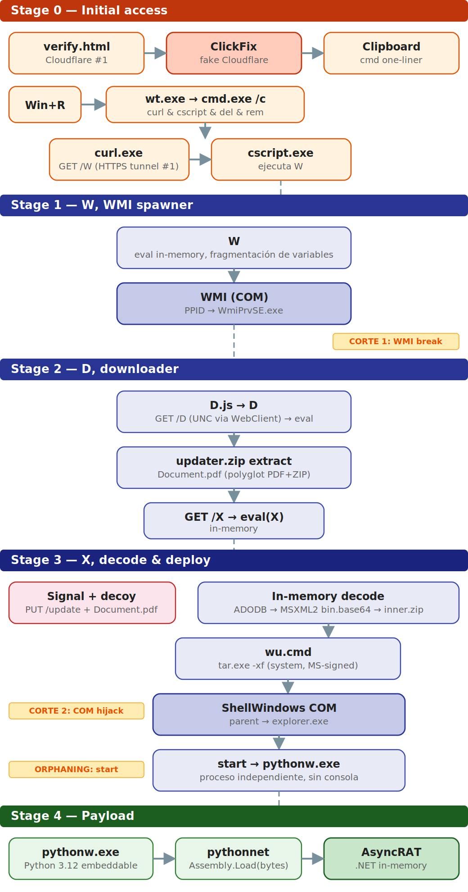
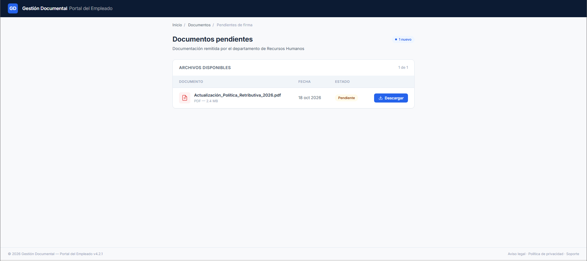
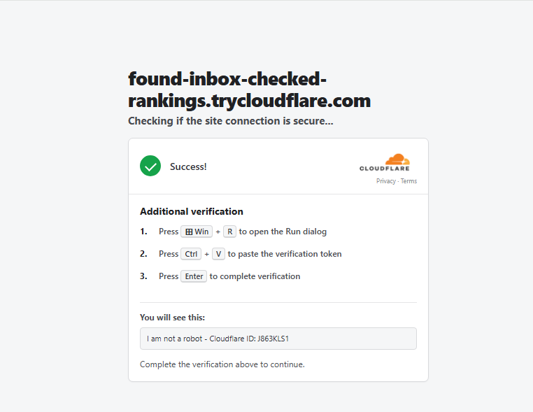
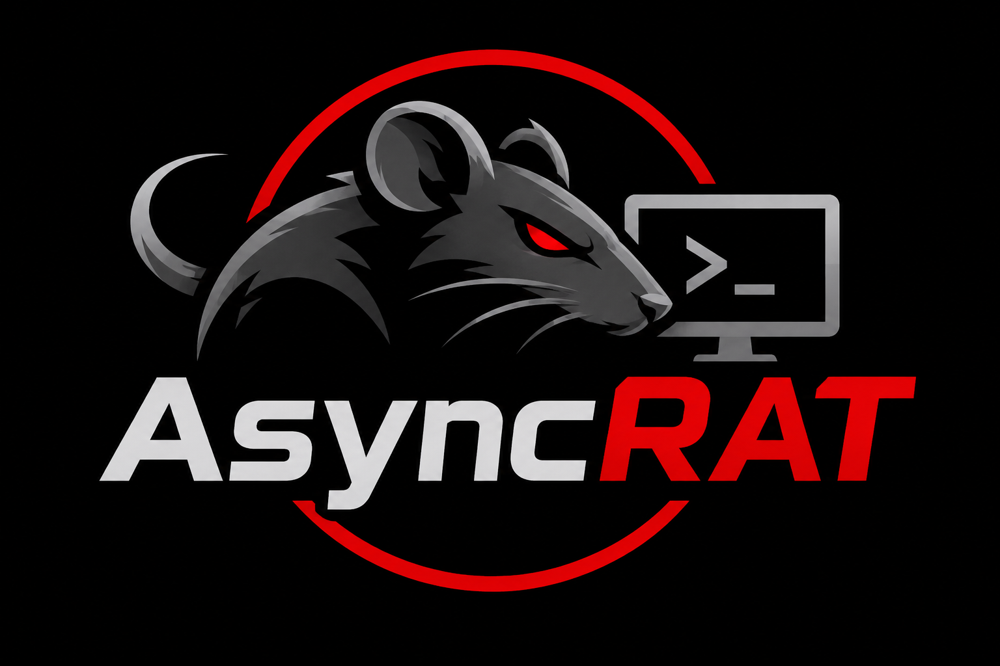

## Introducción

ClickFix es una técnica de ingeniería social donde una página web copia un comando al portapapeles de la víctima y la guía para que ella misma lo ejecute en el cuadro Ejecutar (Win+R, Ctrl+V, Enter). No hay exploit, no hay adjunto malicioso: es el propio usuario quien ejecuta el acceso inicial. El comando, normalmente un *one-liner* de PowerShell o `cmd`, descarga y lanza el primer stage de la cadena.

La razón por la que funciona tan bien es sencilla: el comando no es un fichero descargado, así que las defensas que dependen del Mark of the Web no tienen nada que evaluar. SmartScreen, Protected View, el bloqueo de macros: ninguno interviene porque el comando nace directamente en el cuadro Ejecutar, sin MotW, sin zona de Internet y sin reputación. En el *Digital Defense Report 2025* de Microsoft fue el vector de acceso inicial más observado del año. ESET midió un incremento del 517% en detecciones en solo seis meses. Y lo usan actores de todo el espectro, desde bandas de cibercrimen hasta APTs de Corea del Norte, Irán y Rusia.

En este artículo desmontamos una cadena completa que construimos y ejecutamos nosotros: desde el falso captcha de ClickFix hasta AsyncRAT. Cinco stages que rompen dos veces la relación padre-hijo y desacoplan el payload final, un PDF *polyglot* cuyo ZIP se decodifica en memoria, y un `pythonw.exe` que carga AsyncRAT como ensamblado .NET en memoria.

## Estado del arte de la ingeniería social

Cada vector de entrega de la última década se apoya en lo mismo y cae por lo mismo: el Mark of the Web (MotW), la marca que Windows pone a todo fichero descargado. Técnicamente es un *Alternate Data Stream* (`Zone.Identifier`) que Windows adjunta al fichero y que guarda de qué zona procede. Ese valor, el `ZoneId`, es el que dictamina cuánto se fía Windows del fichero, y es justo lo que leen SmartScreen, Protected View y el bloqueo de macros de Office:

| ZoneId | Zona | Comportamiento |
|:------:|------|----------------|
| `0` | Local machine | Ficheros creados en la propia máquina, no vienen de ningún sitio. Sin avisos. |
| `1` | Local intranet | Ficheros de un SMB de un equipo del dominio o similares. Pocas restricciones. |
| `2` | Trusted sites | URLs añadidas expresamente a la zona de sitios de confianza. Pocas restricciones. |
| `3` | Internet | Valor por defecto de lo descargado de Internet. Aquí entran SmartScreen y Protected View. |
| `4` | Restricted sites | URLs de la zona de sitios restringidos. Restricciones severas. |

Con eso claro, repasar el mapa de vector y contramedida deja a la vista la jugada de ClickFix.

| Vector | Cómo funciona | Cómo se bloquea |
|--------|---------------|-----------------|
| Macros de Office | Documento de Word o Excel con una macro VBA que el usuario habilita con un clic. | Protected View (lo abre aislado y en solo lectura) y el bloqueo por defecto de macros en ficheros con MotW (Office, 2022), ya sin un "Habilitar" cómodo. |
| Contenedores (ISO, VHD, ZIP con contraseña) | Esconden el payload en una imagen o archivo cuyo contenido no heredaba el MotW al montarlo o extraerlo; el `.lnk` o el script de dentro corría sin controles. | Microsoft propaga el MotW al contenido de imágenes y archivos. |
| WebDAV y `search-ms` | Abren en el Explorador ficheros remotos haciéndolos pasar por locales y sin marca de Internet. | Parches a los casos concretos, como Copy2Pwn (CVE-2024-38213), en junio de 2024. |
| HTML smuggling | Reconstruye el fichero dentro del navegador con JavaScript para que el gateway de correo solo vea HTML. | El fichero que cae a disco sigue llevando MotW; lo vigila SmartScreen por reputación. |

El patrón es evidente: Protected View, bloqueo de macros, SmartScreen y los parches de propagación giran todos alrededor de un fichero descargado y su MotW. ClickFix rompe la premisa: no entrega fichero. El comando lo teclea el usuario en el cuadro Ejecutar, así que no hay descarga, no hay MotW y no hay nada que esos controles puedan mirar. No es un vector más de la lista, es quitarle a la defensa su punto de anclaje.

## Anatomía de una kill-chain con ClickFix

Con el porqué claro, toca ver cómo es una kill-chain de ClickFix de principio a fin. Y lo primero, antes del comando, es cómo llega el señuelo a la víctima. Los informes de los últimos meses reparten ese acceso inicial en unos pocos vectores, que combinan dónde se aloja el señuelo con de qué se disfraza. Los repasamos y cerramos con el que vamos a simular nosotros.

### Sitios web comprometidos

Es el vector más común, con diferencia, y el que da más alcance con menos esfuerzo. El atacante no monta su propia web: compromete sitios legítimos (plugins de WordPress vulnerables, credenciales robadas) e inyecta un pequeño cargador de JavaScript. Ese cargador no dispara el señuelo a todo el mundo; primero hace fingerprinting del visitante (geolocalización, navegador, si parece un bot o un investigador) y solo a los objetivos que encajan les superpone la página falsa, un CAPTCHA o un "verifica que eres humano". Es el modelo de ClearFake y de clusters de web-inject como KongTuke, que Trend Micro observó sobre miles de WordPress comprometidos.

La variante más interesante es la que analizó Filescan: en vez de llevar la dirección del siguiente servidor escrita en el JavaScript, la lee de un contrato inteligente en una blockchain pública (EtherHiding). El contrato es un puntero fijo que cualquiera puede leer pero solo el atacante puede actualizar, así que tirar abajo los dominios no mata la configuración, basta con apuntar el contrato a uno nuevo. Elastic documentó otra cadena sobre sitios legítimos que terminaba entregando un RAT propio, MIMICRAT.

<svg viewBox="0 0 778 80" role="img" aria-labelledby="v1-t v1-d" style="display:block;min-width:560px;width:100%;height:auto;font-family:ui-monospace,SFMono-Regular,Menlo,monospace;">
<title id="v1-t">Ejecución: sitio web comprometido</title>
<desc id="v1-d">El visitante de una web legítima recibe un JavaScript inyectado que superpone el señuelo ClickFix y acaba ejecutando el comando.</desc>
<defs><marker id="v1a" viewBox="0 0 10 10" refX="8" refY="5" markerWidth="7" markerHeight="7" orient="auto-start-reverse"><path d="M0,0 L10,5 L0,10 z" fill="var(--accent,#7aa2f7)"/></marker></defs>
<rect x="10" y="18" width="170" height="44" rx="9" fill="var(--entry,#16181d)" stroke="var(--border,#2a2e37)"/>
<text x="95" y="45" text-anchor="middle" font-size="13" font-weight="700" fill="var(--primary,#e6e8ea)">Web legítima</text>
<rect x="206" y="18" width="170" height="44" rx="9" fill="var(--entry,#16181d)" stroke="var(--border,#2a2e37)"/>
<text x="291" y="45" text-anchor="middle" font-size="13" font-weight="700" fill="var(--primary,#e6e8ea)">JS inyectado</text>
<rect x="402" y="18" width="170" height="44" rx="9" fill="var(--entry,#16181d)" stroke="var(--border,#2a2e37)"/>
<text x="487" y="45" text-anchor="middle" font-size="13" font-weight="700" fill="var(--primary,#e6e8ea)">Overlay ClickFix</text>
<rect x="598" y="18" width="170" height="44" rx="9" fill="var(--entry,#16181d)" stroke="var(--accent,#7aa2f7)" stroke-width="1.8"/>
<text x="683" y="45" text-anchor="middle" font-size="13" font-weight="700" fill="var(--primary,#e6e8ea)">Usuario ejecuta</text>
<line x1="180" y1="40" x2="204" y2="40" stroke="var(--accent,#7aa2f7)" stroke-width="2.2" marker-end="url(#v1a)"/>
<line x1="376" y1="40" x2="400" y2="40" stroke="var(--accent,#7aa2f7)" stroke-width="2.2" marker-end="url(#v1a)"/>
<line x1="572" y1="40" x2="596" y2="40" stroke="var(--accent,#7aa2f7)" stroke-width="2.2" marker-end="url(#v1a)"/>
</svg>

### Malvertising y SEO poisoning

Si el atacante no quiere esperar a que la víctima pase por una web comprometida, la atrae él. El malvertising compra anuncios, a menudo sobre búsquedas de software popular o herramientas de IA, y el SEO poisoning manipula el posicionamiento para colar un resultado malicioso en lo alto. La víctima, que buscaba descargar algo legítimo, pincha el anuncio o el primer resultado y aterriza en un dominio del atacante que, en lugar de la descarga, le muestra el CAPTCHA falso. Así arranca la cadena de CORNFLAKE.V3 que describió Mandiant, y el mismo patrón, partiendo de anuncios y búsquedas envenenadas, aparece en las campañas de ACR Stealer que analizó Microsoft. Es un vector especialmente eficaz porque la víctima llega con la guardia baja: ha sido ella quien ha buscado.

<svg viewBox="0 0 778 80" role="img" aria-labelledby="v2-t v2-d" style="display:block;min-width:560px;width:100%;height:auto;font-family:ui-monospace,SFMono-Regular,Menlo,monospace;">
<title id="v2-t">Ejecución: malvertising y SEO poisoning</title>
<desc id="v2-d">La víctima busca software, pincha un anuncio o resultado envenenado, llega a un dominio con el señuelo ClickFix y ejecuta el comando.</desc>
<defs><marker id="v2a" viewBox="0 0 10 10" refX="8" refY="5" markerWidth="7" markerHeight="7" orient="auto-start-reverse"><path d="M0,0 L10,5 L0,10 z" fill="var(--accent,#7aa2f7)"/></marker></defs>
<rect x="10" y="18" width="170" height="44" rx="9" fill="var(--entry,#16181d)" stroke="var(--border,#2a2e37)"/>
<text x="95" y="45" text-anchor="middle" font-size="12.5" font-weight="700" fill="var(--primary,#e6e8ea)">Búsqueda / anuncio</text>
<rect x="206" y="18" width="170" height="44" rx="9" fill="var(--entry,#16181d)" stroke="var(--border,#2a2e37)"/>
<text x="291" y="45" text-anchor="middle" font-size="12.5" font-weight="700" fill="var(--primary,#e6e8ea)">Resultado envenenado</text>
<rect x="402" y="18" width="170" height="44" rx="9" fill="var(--entry,#16181d)" stroke="var(--border,#2a2e37)"/>
<text x="487" y="45" text-anchor="middle" font-size="13" font-weight="700" fill="var(--primary,#e6e8ea)">Señuelo ClickFix</text>
<rect x="598" y="18" width="170" height="44" rx="9" fill="var(--entry,#16181d)" stroke="var(--accent,#7aa2f7)" stroke-width="1.8"/>
<text x="683" y="45" text-anchor="middle" font-size="13" font-weight="700" fill="var(--primary,#e6e8ea)">Usuario ejecuta</text>
<line x1="180" y1="40" x2="204" y2="40" stroke="var(--accent,#7aa2f7)" stroke-width="2.2" marker-end="url(#v2a)"/>
<line x1="376" y1="40" x2="400" y2="40" stroke="var(--accent,#7aa2f7)" stroke-width="2.2" marker-end="url(#v2a)"/>
<line x1="572" y1="40" x2="596" y2="40" stroke="var(--accent,#7aa2f7)" stroke-width="2.2" marker-end="url(#v2a)"/>
</svg>

### Correo de phishing

El clásico sigue en la mezcla, aunque aquí el correo no lleva el payload: lleva solo el gancho que termina en la página de ClickFix. El cuerpo trae un enlace, o un adjunto ligero (un HTML, un PDF, un ZIP) que redirige al señuelo, de modo que lo que viaja por correo es inofensivo y los filtros no tienen un fichero malicioso que analizar. Su ventaja es la segmentación: el atacante elige idioma, sector y tema (una factura, un aviso de Hacienda, un mensaje de RRHH). Microsoft documentó a Storm-0426 lanzando miles de correos dirigidos a usuarios en Alemania para acabar colando MintsLoader.

<svg viewBox="0 0 778 80" role="img" aria-labelledby="v3-t v3-d" style="display:block;min-width:560px;width:100%;height:auto;font-family:ui-monospace,SFMono-Regular,Menlo,monospace;">
<title id="v3-t">Ejecución: correo de phishing</title>
<desc id="v3-d">Un correo con un enlace o adjunto ligero redirige a la página de ClickFix, donde el usuario ejecuta el comando.</desc>
<defs><marker id="v3a" viewBox="0 0 10 10" refX="8" refY="5" markerWidth="7" markerHeight="7" orient="auto-start-reverse"><path d="M0,0 L10,5 L0,10 z" fill="var(--accent,#7aa2f7)"/></marker></defs>
<rect x="10" y="18" width="170" height="44" rx="9" fill="var(--entry,#16181d)" stroke="var(--border,#2a2e37)"/>
<text x="95" y="45" text-anchor="middle" font-size="13" font-weight="700" fill="var(--primary,#e6e8ea)">Correo</text>
<rect x="206" y="18" width="170" height="44" rx="9" fill="var(--entry,#16181d)" stroke="var(--border,#2a2e37)"/>
<text x="291" y="45" text-anchor="middle" font-size="13" font-weight="700" fill="var(--primary,#e6e8ea)">Enlace / adjunto</text>
<rect x="402" y="18" width="170" height="44" rx="9" fill="var(--entry,#16181d)" stroke="var(--border,#2a2e37)"/>
<text x="487" y="45" text-anchor="middle" font-size="13" font-weight="700" fill="var(--primary,#e6e8ea)">Página ClickFix</text>
<rect x="598" y="18" width="170" height="44" rx="9" fill="var(--entry,#16181d)" stroke="var(--accent,#7aa2f7)" stroke-width="1.8"/>
<text x="683" y="45" text-anchor="middle" font-size="13" font-weight="700" fill="var(--primary,#e6e8ea)">Usuario ejecuta</text>
<line x1="180" y1="40" x2="204" y2="40" stroke="var(--accent,#7aa2f7)" stroke-width="2.2" marker-end="url(#v3a)"/>
<line x1="376" y1="40" x2="400" y2="40" stroke="var(--accent,#7aa2f7)" stroke-width="2.2" marker-end="url(#v3a)"/>
<line x1="572" y1="40" x2="596" y2="40" stroke="var(--accent,#7aa2f7)" stroke-width="2.2" marker-end="url(#v3a)"/>
</svg>

### Suplantación de marcas y servicios

Este no es tanto un canal como la capa de engaño que se monta encima de los anteriores: de qué se disfraza el señuelo para que la víctima obedezca. Casi siempre imita algo que ya espera ver, una verificación "no soy un robot" (reCAPTCHA, Cloudflare Turnstile), un "actualiza el navegador" o un paso para entrar a una reunión. SentinelOne lo agrupó bajo la idea de "verification fatigue": estamos tan acostumbrados a pasar CAPTCHAs que seguimos las instrucciones sin pensar. Y cuando el objetivo es concreto, el disfraz se afina, con señuelos que imitan marcas de IA o, como documentó Moonlock, falsos fondos de inversión para captar a talento cripto. El denominador común es que el acceso inicial ya no depende de un fallo ni de un adjunto: depende de llevar a la víctima a una página y de que esa página la convenza para abrir Ejecutar y pegar el comando.

<svg viewBox="0 0 778 80" role="img" aria-labelledby="v4-t v4-d" style="display:block;min-width:560px;width:100%;height:auto;font-family:ui-monospace,SFMono-Regular,Menlo,monospace;">
<title id="v4-t">Ejecución: suplantación de marcas y servicios</title>
<desc id="v4-d">El señuelo imita una marca o servicio esperado, muestra una verificación falsa con una instrucción Win+R y la víctima ejecuta el comando.</desc>
<defs><marker id="v4a" viewBox="0 0 10 10" refX="8" refY="5" markerWidth="7" markerHeight="7" orient="auto-start-reverse"><path d="M0,0 L10,5 L0,10 z" fill="var(--accent,#7aa2f7)"/></marker></defs>
<rect x="10" y="18" width="170" height="44" rx="9" fill="var(--entry,#16181d)" stroke="var(--border,#2a2e37)"/>
<text x="95" y="45" text-anchor="middle" font-size="13" font-weight="700" fill="var(--primary,#e6e8ea)">Marca imitada</text>
<rect x="206" y="18" width="170" height="44" rx="9" fill="var(--entry,#16181d)" stroke="var(--border,#2a2e37)"/>
<text x="291" y="45" text-anchor="middle" font-size="13" font-weight="700" fill="var(--primary,#e6e8ea)">Verificación falsa</text>
<rect x="402" y="18" width="170" height="44" rx="9" fill="var(--entry,#16181d)" stroke="var(--border,#2a2e37)"/>
<text x="487" y="45" text-anchor="middle" font-size="13" font-weight="700" fill="var(--primary,#e6e8ea)">Instrucción Win+R</text>
<rect x="598" y="18" width="170" height="44" rx="9" fill="var(--entry,#16181d)" stroke="var(--accent,#7aa2f7)" stroke-width="1.8"/>
<text x="683" y="45" text-anchor="middle" font-size="13" font-weight="700" fill="var(--primary,#e6e8ea)">Usuario ejecuta</text>
<line x1="180" y1="40" x2="204" y2="40" stroke="var(--accent,#7aa2f7)" stroke-width="2.2" marker-end="url(#v4a)"/>
<line x1="376" y1="40" x2="400" y2="40" stroke="var(--accent,#7aa2f7)" stroke-width="2.2" marker-end="url(#v4a)"/>
<line x1="572" y1="40" x2="596" y2="40" stroke="var(--accent,#7aa2f7)" stroke-width="2.2" marker-end="url(#v4a)"/>
</svg>

## Emulando a un adversario

Con el panorama claro, toca construir y ejecutar nuestra propia cadena. La simulación usa ClickFix como señuelo, montado sobre un falso portal de Recursos Humanos con una verificación de Cloudflare. Dos túneles de Cloudflare sostienen toda la operación: uno sirve la web del señuelo y el primer stage, y otro expone un servidor WebDAV con el resto de stages y los artefactos.

La cadena progresa en cinco stages (0 a 4). Antes de entrar en cada uno, este es el recorrido completo de un vistazo:

| Stage | Nombre | Qué hace |
|:-----:|--------|----------|
| 0 | Acceso inicial | ClickFix copia un comando al portapapeles y la víctima lo ejecuta en Win+R; `wt.exe` lanza `curl` y `cscript` |
| 1 | W, *spawner* | Rompe el árbol de procesos con un salto por WMI |
| 2 | D, *downloader* | Trae los artefactos a disco desde el WebDAV |
| 3 | X, despliegue | Decodifica el PDF *polyglot* en memoria y lanza el payload con un segundo corte de parentesco |
| 4 | Payload | `pythonw.exe` carga AsyncRAT como ensamblado .NET en memoria |

Dos de esos saltos son cortes reales de parentesco: el proceso siguiente nace con un padre distinto (WMI en el Stage 1, *ShellWindows* COM en el Stage 3) y la telemetría del EDR pierde el hilo. El tercero, el salto al payload, no lo es: es un *process orphaning* con `start`, en el que el proceso conserva el PID de su padre pero sobrevive a su cierre. La diferencia importa y volveremos sobre ella al final.

### Infraestructura: dos túneles de Cloudflare

Toda la operación se apoya en dos túneles de Cloudflare que exponen servicios locales a internet sin abrir puertos ni mostrar la IP del operador. El tráfico sale por un dominio de confianza (Cloudflare), lo que ayuda a esquivar filtros por reputación.

| Túnel | Tipo | Propósito |
|-------|------|-----------|
| Tunnel 1 | Web | Portal de RRHH falso + página ClickFix + primer stage |
| Tunnel 2 | WebDAV | Stages JScript, artefactos y señalización |

El primer túnel sirve la web del señuelo: un portal de Recursos Humanos con una verificación falsa de Cloudflare. También sirve el primer stage (`W`) por HTTPS, lo que elimina la dependencia del servicio WebClient en la fase inicial. El segundo expone un servidor WebDAV que aloja los stages restantes, el ZIP con el payload y el endpoint `/update` que el señuelo usa para saber cuándo la cadena ha avanzado.

<svg viewBox="0 0 820 412" role="img" aria-labelledby="net-t net-d" style="display:block;min-width:620px;width:100%;height:auto;font-family:ui-monospace,SFMono-Regular,Menlo,monospace;">
<title id="net-t">Diagrama de conexiones</title>
<desc id="net-d">Diagrama de secuencia con cuatro actores: Víctima, Cloudflare, Atacante y Team Server. Siete mensajes numerados cruzan Cloudflare por el túnel 1 o 2 hasta los servidores del atacante; un octavo, la conexión C2 de AsyncRAT, sale directa por TCP desde pythonw.exe al Team Server sin pasar por Cloudflare.</desc>
<defs>
  <marker id="naT1s" viewBox="0 0 10 10" refX="8" refY="5" markerWidth="7" markerHeight="7" orient="auto-start-reverse"><path d="M0,0 L10,5 L0,10 z" fill="var(--accent,#7aa2f7)"/></marker>
  <marker id="naT2s" viewBox="0 0 10 10" refX="8" refY="5" markerWidth="7" markerHeight="7" orient="auto-start-reverse"><path d="M0,0 L10,5 L0,10 z" fill="#bb9af7"/></marker>
  <marker id="naC2s" viewBox="0 0 10 10" refX="8" refY="5" markerWidth="7" markerHeight="7" orient="auto-start-reverse"><path d="M0,0 L10,5 L0,10 z" fill="#f7768e"/></marker>
</defs>
<!-- Líneas de vida -->
<rect x="382" y="72" width="56" height="250" fill="#F6A623" opacity="0.08"/>
<line x1="120" y1="72" x2="120" y2="356" stroke="var(--border,#2a2e37)" stroke-width="1" stroke-dasharray="4 4"/>
<line x1="410" y1="72" x2="410" y2="322" stroke="#F6A623" stroke-width="1" stroke-dasharray="4 4" opacity="0.6"/>
<line x1="700" y1="72" x2="700" y2="322" stroke="var(--border,#2a2e37)" stroke-width="1" stroke-dasharray="4 4"/>
<!-- Cabeceras -->
<rect x="40" y="8" width="160" height="64" rx="10" fill="var(--entry,#16181d)" stroke="var(--border,#2a2e37)" stroke-width="1.5"/>
<text x="120" y="28" text-anchor="middle" font-size="12" font-weight="700" fill="var(--primary,#e6e8ea)">Víctima</text>
<text x="120" y="46" text-anchor="middle" font-size="9" fill="var(--secondary,#9aa0ab)">Navegador · curl</text>
<text x="120" y="60" text-anchor="middle" font-size="9" fill="var(--secondary,#9aa0ab)">cscript · svchost · pythonw</text>
<rect x="330" y="8" width="160" height="64" rx="10" fill="var(--entry,#16181d)" stroke="#F6A623" stroke-width="1.5"/>
<text x="410" y="28" text-anchor="middle" font-size="12" font-weight="700" fill="#F6A623">Cloudflare</text>
<text x="410" y="46" text-anchor="middle" font-size="9" fill="var(--secondary,#9aa0ab)">Tunnel 1 · Web</text>
<text x="410" y="60" text-anchor="middle" font-size="9" fill="var(--secondary,#9aa0ab)">Tunnel 2 · WebDAV</text>
<rect x="620" y="8" width="160" height="64" rx="10" fill="var(--entry,#16181d)" stroke="var(--border,#2a2e37)" stroke-width="1.5"/>
<text x="700" y="28" text-anchor="middle" font-size="12" font-weight="700" fill="var(--primary,#e6e8ea)">Atacante</text>
<text x="700" y="46" text-anchor="middle" font-size="9" fill="var(--secondary,#9aa0ab)">Web + WebDAV local</text>
<text x="700" y="60" text-anchor="middle" font-size="9" fill="var(--secondary,#9aa0ab)">IP oculta</text>
<!-- 1 -->
<text x="140" y="92" text-anchor="start" font-size="10" fill="var(--secondary,#9aa0ab)">Navegador · GET /index.html, /verify.html</text>
<line x1="134" y1="100" x2="694" y2="100" stroke="var(--accent,#7aa2f7)" stroke-width="1.8" marker-end="url(#naT1s)"/>
<circle cx="120" cy="100" r="10" fill="var(--accent,#7aa2f7)"/>
<text x="120" y="103.5" text-anchor="middle" font-size="10" font-weight="700" fill="var(--entry,#16181d)">1</text>
<rect x="398" y="93" width="24" height="14" rx="4" fill="var(--accent,#7aa2f7)"/>
<text x="410" y="103" text-anchor="middle" font-size="8.5" font-weight="700" fill="var(--entry,#16181d)">T1</text>
<!-- 2 -->
<text x="140" y="128" text-anchor="start" font-size="10" fill="var(--secondary,#9aa0ab)">curl.exe · GET /W (HTTPS)</text>
<line x1="134" y1="136" x2="694" y2="136" stroke="var(--accent,#7aa2f7)" stroke-width="1.8" marker-end="url(#naT1s)"/>
<circle cx="120" cy="136" r="10" fill="var(--accent,#7aa2f7)"/>
<text x="120" y="139.5" text-anchor="middle" font-size="10" font-weight="700" fill="var(--entry,#16181d)">2</text>
<rect x="398" y="129" width="24" height="14" rx="4" fill="var(--accent,#7aa2f7)"/>
<text x="410" y="139" text-anchor="middle" font-size="8.5" font-weight="700" fill="var(--entry,#16181d)">T1</text>
<!-- 3 -->
<text x="140" y="164" text-anchor="start" font-size="10" fill="var(--secondary,#9aa0ab)">svchost · GET /D (UNC→HTTPS)</text>
<line x1="134" y1="172" x2="694" y2="172" stroke="#bb9af7" stroke-width="1.8" marker-end="url(#naT2s)"/>
<circle cx="120" cy="172" r="10" fill="#bb9af7"/>
<text x="120" y="175.5" text-anchor="middle" font-size="10" font-weight="700" fill="var(--entry,#16181d)">3</text>
<rect x="398" y="165" width="24" height="14" rx="4" fill="#bb9af7"/>
<text x="410" y="175" text-anchor="middle" font-size="8.5" font-weight="700" fill="var(--entry,#16181d)">T2</text>
<!-- 4 -->
<text x="140" y="200" text-anchor="start" font-size="10" fill="var(--secondary,#9aa0ab)">svchost · GET /updater.zip</text>
<line x1="134" y1="208" x2="694" y2="208" stroke="#bb9af7" stroke-width="1.8" marker-end="url(#naT2s)"/>
<circle cx="120" cy="208" r="10" fill="#bb9af7"/>
<text x="120" y="211.5" text-anchor="middle" font-size="10" font-weight="700" fill="var(--entry,#16181d)">4</text>
<rect x="398" y="201" width="24" height="14" rx="4" fill="#bb9af7"/>
<text x="410" y="211" text-anchor="middle" font-size="8.5" font-weight="700" fill="var(--entry,#16181d)">T2</text>
<!-- 5 -->
<text x="140" y="236" text-anchor="start" font-size="10" fill="var(--secondary,#9aa0ab)">svchost · GET /X (UNC→HTTPS)</text>
<line x1="134" y1="244" x2="694" y2="244" stroke="#bb9af7" stroke-width="1.8" marker-end="url(#naT2s)"/>
<circle cx="120" cy="244" r="10" fill="#bb9af7"/>
<text x="120" y="247.5" text-anchor="middle" font-size="10" font-weight="700" fill="var(--entry,#16181d)">5</text>
<rect x="398" y="237" width="24" height="14" rx="4" fill="#bb9af7"/>
<text x="410" y="247" text-anchor="middle" font-size="8.5" font-weight="700" fill="var(--entry,#16181d)">T2</text>
<!-- 6 -->
<text x="140" y="272" text-anchor="start" font-size="10" fill="var(--secondary,#9aa0ab)">svchost · PUT /update (señalización)</text>
<line x1="134" y1="280" x2="694" y2="280" stroke="#bb9af7" stroke-width="1.8" marker-end="url(#naT2s)"/>
<circle cx="120" cy="280" r="10" fill="#bb9af7"/>
<text x="120" y="283.5" text-anchor="middle" font-size="10" font-weight="700" fill="var(--entry,#16181d)">6</text>
<rect x="398" y="273" width="24" height="14" rx="4" fill="#bb9af7"/>
<text x="410" y="283" text-anchor="middle" font-size="8.5" font-weight="700" fill="var(--entry,#16181d)">T2</text>
<!-- 7 -->
<text x="140" y="308" text-anchor="start" font-size="10" fill="var(--secondary,#9aa0ab)">Navegador · HEAD /update (polling)</text>
<line x1="134" y1="316" x2="694" y2="316" stroke="#bb9af7" stroke-width="1.8" marker-end="url(#naT2s)"/>
<circle cx="120" cy="316" r="10" fill="#bb9af7"/>
<text x="120" y="319.5" text-anchor="middle" font-size="10" font-weight="700" fill="var(--entry,#16181d)">7</text>
<rect x="398" y="309" width="24" height="14" rx="4" fill="#bb9af7"/>
<text x="410" y="319" text-anchor="middle" font-size="8.5" font-weight="700" fill="var(--entry,#16181d)">T2</text>
<!-- Separador C2 -->
<line x1="40" y1="334" x2="600" y2="334" stroke="var(--border,#2a2e37)" stroke-width="1" stroke-dasharray="2 4" opacity="0.5"/>
<text x="160" y="330" text-anchor="start" font-size="9" font-style="italic" fill="var(--secondary,#9aa0ab)">C2 de AsyncRAT — directo, fuera de Cloudflare</text>
<!-- Team Server -->
<rect x="620" y="330" width="160" height="52" rx="10" fill="var(--entry,#16181d)" stroke="#f7768e" stroke-width="1.5"/>
<text x="700" y="350" text-anchor="middle" font-size="12" font-weight="700" fill="var(--primary,#e6e8ea)">Team Server</text>
<text x="700" y="366" text-anchor="middle" font-size="9" fill="var(--secondary,#9aa0ab)">AsyncRAT C2</text>
<text x="700" y="378" text-anchor="middle" font-size="9" fill="var(--secondary,#9aa0ab)">TCP 8888 · AES</text>
<!-- 8 -->
<text x="140" y="348" text-anchor="start" font-size="10" fill="var(--secondary,#9aa0ab)">pythonw.exe · AsyncRAT → Team Server (TCP 8888 · AES)</text>
<line x1="134" y1="356" x2="618" y2="356" stroke="#f7768e" stroke-width="1.8" marker-end="url(#naC2s)"/>
<circle cx="120" cy="356" r="10" fill="#f7768e"/>
<text x="120" y="359.5" text-anchor="middle" font-size="10" font-weight="700" fill="var(--entry,#16181d)">8</text>
<text x="140" y="372" text-anchor="start" font-size="8.5" font-style="italic" fill="var(--secondary,#9aa0ab)">PoC: directo · en un despliegue real iría por un redirector</text>
<!-- Leyenda -->
<rect x="120" y="394" width="14" height="10" rx="2" fill="var(--accent,#7aa2f7)"/>
<text x="140" y="403" text-anchor="start" font-size="9" fill="var(--secondary,#9aa0ab)">T1 · Web (HTTPS)</text>
<rect x="300" y="394" width="14" height="10" rx="2" fill="#bb9af7"/>
<text x="320" y="403" text-anchor="start" font-size="9" fill="var(--secondary,#9aa0ab)">T2 · WebDAV (UNC→HTTPS)</text>
<rect x="540" y="394" width="14" height="10" rx="2" fill="#f7768e"/>
<text x="560" y="403" text-anchor="start" font-size="9" fill="var(--secondary,#9aa0ab)">C2 · TCP directo</text>
</svg>

### Por qué importa el proceso padre

Los EDR modernos no se limitan a analizar un proceso de forma aislada: reconstruyen el árbol de procesos y evalúan la cadena completa. Un `cscript.exe` solo no levanta alertas, pero un `cscript.exe` hijo de `cmd.exe`, que a su vez cuelga de `wt.exe` lanzado desde el cuadro Ejecutar, cuenta una historia que las reglas de detección reconocen. Lo mismo pasa con el payload final: si `pythonw.exe` aparece como descendiente directo de `cscript`, la correlación entre script engine y runtime sospechoso es inmediata.

Romper esa cadena de parentesco es romper la narrativa que el EDR necesita para tomar una decisión. Si el nuevo proceso nace con un parent diferente (un servicio del sistema, `explorer.exe`, un proceso independiente), la telemetría pierde el hilo y la cadena de ejecución parece legítima. Cada corte de parentesco en esta cadena responde a eso: forzar que el siguiente stage aparezca en un contexto que el EDR no pueda correlacionar con el anterior.

### Diseño

El recorrido ya está sobre la mesa; toca ver cada stage en detalle y la decisión de diseño que hay detrás de cada uno.

#### Stage 0: acceso inicial

La víctima llega a `index.html`, un portal falso de Recursos Humanos servido por el primer túnel de Cloudflare.

La página redirige a `verify.html`, que imita una verificación de Cloudflare con un checkbox "Verify you are human". Al hacer clic, `navigator.clipboard.writeText()` copia un comando al portapapeles. Las instrucciones hacen el resto: Win+R, Ctrl+V, Enter.

Lo que se pega en el cuadro Ejecutar es un comando que lanza `wt.exe` (Windows Terminal) como wrapper de `cmd.exe /c`. Dentro de esa sesión de `cmd` se encadenan cuatro operaciones: `curl` descarga el primer stage por HTTPS desde el túnel web, `cscript` lo ejecuta, `del` lo borra y un `rem` con texto de ingeniería social cierra la línea. La URL del servidor está ofuscada dentro del comando. En el cuadro Ejecutar, la víctima solo ve la parte final del texto (el comentario del `rem` que simula un ID de verificación de Cloudflare) y el engaño se refuerza.

El uso de `wt.exe` en lugar de `cmd.exe` directo evita detecciones que buscan comandos de Windows lanzados desde el cuadro Ejecutar. Y la descarga con `curl` por HTTPS elimina la necesidad del servicio WebClient en la fase inicial, evitando las detecciones de ejecución de scripts desde WebDAV.

#### Stage 1: W, WMI *spawner*

El código de `W` llega al proceso de `cscript` del Stage 0. Su trabajo es romper el árbol de procesos antes de que se ejecute nada pesado. Escribe un *loader* mínimo en `%TEMP%` y lo lanza a través de WMI COM: obtiene la conexión con `WbemScripting.SWbemLocator`, oculta la ventana con `ShowWindow = 0` y crea el proceso con `Win32_Process.Create`. La ruta UNC del WebDAV se construye fragmentando las cadenas en variables que se concatenan en *runtime*.

Inmediatamente después, `W` sale. Como era la única tarea del stage anterior, el `cscript` también termina, y con él muere toda la rama visible que colgaba de `explorer.exe → wt.exe → cmd.exe → cscript`. En menos de un segundo, la parte ruidosa del árbol ha desaparecido. Lo que queda vivo es un nuevo proceso de `cscript` cuyo parent es `WmiPrvSE.exe`, el servicio de WMI que ya estaba corriendo en el sistema. La relación directa entre el señuelo y la ejecución se ha cortado.

#### Stage 2: D, *downloader*

El nuevo `cscript` corre bajo `WmiPrvSE.exe`, sin ninguna relación visible con Windows Terminal ni con el cuadro Ejecutar. Descarga el código de D desde el WebDAV por UNC y lo ejecuta con `eval()`. Las peticiones UNC las traduce a HTTPS el servicio WebClient de Windows (`svchost.exe`), que es quien realmente se conecta al túnel de Cloudflare.

Su trabajo es traer los artefactos:

1. Descarga `updater.zip` desde el WebDAV con `ADODB.Stream` y lo guarda en `%TEMP%`.

2. Extrae el ZIP con `Shell.Application.CopyHere()`. Sale `Document.pdf`, un *polyglot* PDF+ZIP: un PDF válido que se abre con cualquier visor y que, embebido entre marcadores PEM tras el `%%EOF`, contiene un bloque Base64 que codifica un segundo ZIP.

3. Espera a que `Document.pdf` exista en disco (*polling*) y a continuación descarga el recurso `X` desde el WebDAV y lo ejecuta con `eval()`. El código del Stage 3 nunca toca disco: se evalúa directamente en memoria dentro del mismo proceso de `cscript`.

#### Stage 3: X, decodificación y despliegue

El código de `X` entra por `eval` y ejecuta la fase más densa de la cadena. Lo primero que hace no es técnico, es de experiencia de usuario.

1. Señaliza a la página del señuelo. Crea un fichero en el endpoint de señalización del WebDAV via UNC. Mientras tanto, `verify.html` lleva haciendo *polling* desde que el usuario pulsó Enter. Cuando recibe respuesta, muestra "Success!" y redirige de vuelta a `index.html`. La víctima ve que la "verificación" ha funcionado y sigue con lo suyo. El bucle de ingeniería social se cierra. A partir de este punto la víctima sigue navegando por el portal con normalidad, lo que abre la puerta a un segundo vector de acceso inicial sobre la misma sesión, pero eso lo veremos en otro post.

2. Abre el señuelo PDF. Lanza el visor por defecto del sistema. La víctima ve un documento que justifica el portal de RRHH.

3. Decodifica la carga oculta dentro del *polyglot*, en memoria. `Document.pdf` contiene, entre marcadores `-----BEGIN CERTIFICATE-----` / `-----END CERTIFICATE-----`, un bloque Base64 que codifica un ZIP. La decodificación se hace en cuatro pasos sin llamar a ningún binario externo:
   - Lee `Document.pdf` como texto con `ADODB.Stream` (charset `iso-8859-1`).
   - Extrae el bloque Base64 entre los marcadores PEM.
   - Decodifica el Base64 a bytes con `MSXML2.DOMDocument`: carga el texto como un nodo con `dataType` `bin.base64` y lee `nodeTypedValue`, que devuelve el array de bytes.
   - Escribe los bytes como un ZIP temporal con un `ADODB.Stream` binario.

4. Escribe un `.cmd` intermedio que hace tres cosas: crea el directorio de destino, extrae el ZIP con `tar.exe` del sistema (firmado por Microsoft, incluido en Windows desde la versión 1803) y lanza el payload con `start`. Al acabar, el `.cmd` borra el ZIP temporal y se borra a sí mismo con `del "%~f0"`.

5. Ejecuta el `.cmd` a través del objeto COM de *ShellWindows*: accede a la ventana del escritorio de `explorer.exe` y ejecuta el `.cmd` como si lo lanzara el propio shell. El parent del `cmd.exe` resultante es `explorer.exe`, no `cscript`. Es el segundo corte de parentesco de la cadena. Una vez lanzado, `cscript` termina.

   Lo que sale del ZIP es la estructura del payload final:

   | Componente | Contenido |
   |------------|-----------|
   | Intérprete | Python 3.12 *embeddable* (`pythonw.exe`, sin consola) |
   | Runtime | DLL del runtime de Python, biblioteca estándar comprimida, fichero de rutas |
   | Puente .NET | pythonnet (conexión Python/.NET Framework) |
   | Script | Script de Python que inicializa el CLR y carga el ensamblado |
   | Payload | `WindowsUpdater.dat` (AsyncRAT, ensamblado .NET cargado en memoria con `Assembly.Load`) |

   `pythonw.exe` se lanza con `start` desde el `.cmd`, creando un proceso que sobrevive al cierre de `cmd.exe`. No es un corte de parentesco real como los dos anteriores: el `ParentProcessId` de `pythonw.exe` sigue apuntando al PID del `cmd.exe` que lo creó. Lo que ocurre es *process orphaning*: cuando `cmd.exe` termina, `pythonw.exe` queda huérfano y la cadena visible se rompe. Un EDR que reconstruya el árbol podría seguir el hilo a través del PID muerto, pero en la práctica la correlación se pierde.

#### Stage 4: carga reflexiva con pythonnet

`pythonw.exe` arranca sin consola y ejecuta el script de Python. A través de pythonnet inicializa el CLR de .NET Framework, lee `WindowsUpdater.dat` desde `data/` con `File.ReadAllBytes` y lo carga con `Assembly.Load(byte[])`: una carga reflexiva donde el ensamblado vive en memoria del proceso sin que el CLR lo registre como assembly cargado desde fichero. El ensamblado existe en disco como `.dat`, no como DLL, lo que evita la detección por extensión, aunque un escáner que analice contenido podría identificarlo. El resultado es AsyncRAT ejecutándose dentro de un proceso que para el sistema operativo es un `pythonw.exe` huérfano colgando de `explorer.exe`.

Juntándolo todo, el árbol de procesos que vería un EDR es este:

<svg viewBox="0 0 780 300" role="img" aria-labelledby="pt-t pt-d" style="display:block;min-width:580px;width:100%;height:auto;font-family:ui-monospace,SFMono-Regular,Menlo,monospace;">
<title id="pt-t">Árbol de procesos visto por el EDR</title>
<desc id="pt-d">explorer.exe lanza wt.exe via Win+R, que lanza cmd.exe con curl y cscript. W usa WMI para crear cscript bajo WmiPrvSE.exe. X ejecuta un .cmd via ShellWindows COM, cuyo parent es explorer.exe. El .cmd lanza tar.exe y pythonw.exe con start.</desc>
<defs><marker id="pt-a" viewBox="0 0 10 10" refX="8" refY="5" markerWidth="7" markerHeight="7" orient="auto-start-reverse"><path d="M0,0 L10,5 L0,10 z" fill="var(--accent,#7aa2f7)"/></marker></defs>
<rect x="6" y="10" width="108" height="34" rx="8" fill="var(--entry,#16181d)" stroke="var(--border,#2a2e37)"/>
<text x="60" y="32" text-anchor="middle" font-size="11.5" font-weight="700" fill="var(--primary,#e6e8ea)">explorer.exe</text>
<line x1="114" y1="27" x2="134" y2="27" stroke="var(--accent,#7aa2f7)" stroke-width="2" marker-end="url(#pt-a)"/>
<rect x="136" y="10" width="78" height="34" rx="8" fill="var(--entry,#16181d)" stroke="var(--border,#2a2e37)"/>
<text x="175" y="32" text-anchor="middle" font-size="11.5" font-weight="700" fill="var(--primary,#e6e8ea)">wt.exe</text>
<line x1="214" y1="27" x2="234" y2="27" stroke="var(--accent,#7aa2f7)" stroke-width="2" marker-end="url(#pt-a)"/>
<rect x="236" y="10" width="110" height="34" rx="8" fill="var(--entry,#16181d)" stroke="var(--border,#2a2e37)"/>
<text x="291" y="32" text-anchor="middle" font-size="11.5" font-weight="700" fill="var(--primary,#e6e8ea)">cmd.exe /c</text>
<line x1="346" y1="20" x2="386" y2="20" stroke="var(--accent,#7aa2f7)" stroke-width="2" marker-end="url(#pt-a)"/>
<rect x="388" y="3" width="100" height="34" rx="8" fill="var(--entry,#16181d)" stroke="var(--border,#2a2e37)"/>
<text x="438" y="25" text-anchor="middle" font-size="11.5" font-weight="700" fill="var(--primary,#e6e8ea)">curl.exe</text>
<line x1="346" y1="34" x2="386" y2="40" stroke="var(--accent,#7aa2f7)" stroke-width="2" marker-end="url(#pt-a)"/>
<rect x="388" y="42" width="170" height="34" rx="8" fill="var(--entry,#16181d)" stroke="var(--border,#2a2e37)"/>
<text x="473" y="64" text-anchor="middle" font-size="11.5" font-weight="700" fill="var(--primary,#e6e8ea)">cscript.exe (W)</text>
<text x="473" y="88" text-anchor="middle" font-size="9.5" fill="var(--secondary,#9aa0ab)">eval(W), luego sale</text>
<path d="M 473 76 C 473 112, 280 116, 160 132" fill="none" stroke="var(--accent,#7aa2f7)" stroke-width="1.5" stroke-dasharray="6 4"/>
<text x="390" y="116" font-size="10" font-style="italic" fill="var(--secondary,#9aa0ab)">Win32_Process.Create</text>
<rect x="6" y="130" width="140" height="34" rx="8" fill="var(--entry,#16181d)" stroke="var(--border,#2a2e37)"/>
<text x="76" y="152" text-anchor="middle" font-size="11.5" font-weight="700" fill="var(--primary,#e6e8ea)">WmiPrvSE.exe</text>
<text x="76" y="176" text-anchor="middle" font-size="9.5" fill="var(--secondary,#9aa0ab)">WMI break</text>
<line x1="146" y1="147" x2="166" y2="147" stroke="var(--accent,#7aa2f7)" stroke-width="2" marker-end="url(#pt-a)"/>
<rect x="168" y="130" width="260" height="34" rx="8" fill="var(--entry,#16181d)" stroke="var(--border,#2a2e37)"/>
<text x="298" y="152" text-anchor="middle" font-size="11.5" font-weight="700" fill="var(--primary,#e6e8ea)">cscript.exe (D → eval(X))</text>
<text x="298" y="176" text-anchor="middle" font-size="9.5" fill="var(--secondary,#9aa0ab)">escribe .cmd, lanza via COM</text>
<path d="M 298 164 C 298 200, 160 204, 80 220" fill="none" stroke="var(--accent,#7aa2f7)" stroke-width="1.5" stroke-dasharray="6 4"/>
<text x="280" y="204" font-size="10" font-style="italic" fill="var(--secondary,#9aa0ab)">ShellWindows COM</text>
<rect x="6" y="222" width="108" height="34" rx="8" fill="var(--entry,#16181d)" stroke="var(--border,#2a2e37)"/>
<text x="60" y="244" text-anchor="middle" font-size="11.5" font-weight="700" fill="var(--primary,#e6e8ea)">explorer.exe</text>
<text x="60" y="268" text-anchor="middle" font-size="9.5" fill="var(--secondary,#9aa0ab)">COM parent</text>
<line x1="114" y1="239" x2="134" y2="239" stroke="var(--accent,#7aa2f7)" stroke-width="2" marker-end="url(#pt-a)"/>
<rect x="136" y="222" width="130" height="34" rx="8" fill="var(--entry,#16181d)" stroke="var(--border,#2a2e37)"/>
<text x="201" y="244" text-anchor="middle" font-size="11.5" font-weight="700" fill="var(--primary,#e6e8ea)">cmd.exe (.cmd)</text>
<line x1="266" y1="232" x2="296" y2="228" stroke="var(--accent,#7aa2f7)" stroke-width="2" marker-end="url(#pt-a)"/>
<rect x="298" y="212" width="120" height="34" rx="8" fill="var(--entry,#16181d)" stroke="var(--border,#2a2e37)"/>
<text x="358" y="234" text-anchor="middle" font-size="11.5" font-weight="700" fill="var(--primary,#e6e8ea)">tar.exe -xf</text>
<line x1="266" y1="246" x2="296" y2="257" stroke="var(--accent,#7aa2f7)" stroke-width="2" marker-end="url(#pt-a)"/>
<rect x="298" y="253" width="210" height="34" rx="8" fill="var(--entry,#16181d)" stroke="var(--accent,#7aa2f7)" stroke-width="1.8"/>
<text x="403" y="275" text-anchor="middle" font-size="11.5" font-weight="700" fill="var(--primary,#e6e8ea)">pythonw.exe (Python 3.12)</text>
<text x="403" y="296" text-anchor="middle" font-size="9.5" fill="var(--secondary,#9aa0ab)">via start, sin consola</text>
<line x1="508" y1="270" x2="528" y2="270" stroke="var(--accent,#7aa2f7)" stroke-width="2" marker-end="url(#pt-a)"/>
<rect x="530" y="253" width="200" height="34" rx="8" fill="var(--entry,#16181d)" stroke="var(--accent,#7aa2f7)" stroke-width="1.8"/>
<text x="630" y="275" text-anchor="middle" font-size="11.5" font-weight="700" fill="var(--primary,#e6e8ea)">CLR + AsyncRAT</text>
<text x="630" y="296" text-anchor="middle" font-size="9.5" fill="var(--secondary,#9aa0ab)">en memoria</text>
</svg>

Lo que salta a la vista son los dos cortes de parentesco y el desacoplamiento final. En el primer corte, el Stage 1 (W) lanza el *downloader* por WMI: el nuevo `cscript` cuelga de `WmiPrvSE.exe`, no de `wt.exe` ni de `cmd.exe`. En el segundo, el Stage 3 (X) ejecuta un `.cmd` a través del objeto COM de *ShellWindows*: el `cmd.exe` resultante aparece como hijo de `explorer.exe`, sin relación alguna con `cscript`. El tercer movimiento es diferente: el `.cmd` lanza `pythonw.exe` con `start`, y cuando `cmd.exe` termina, `pythonw.exe` queda huérfano. Su `ParentProcessId` sigue apuntando al PID muerto.

La secuencia de peticiones resume el flujo completo visto desde la red:

| Petición | Quién la hace | Propósito |
|----------|---------------|-----------|
| `GET /W` (HTTPS, túnel 1) | `curl.exe` (Stage 0) | Descarga Stage 1 a disco |
| `GET /D` (UNC → HTTPS, túnel 2) | `svchost.exe` (WebClient, por cuenta de W) | Descarga Stage 2 → `eval` |
| `GET /updater.zip` (UNC → HTTPS) | `svchost.exe` (WebClient, por cuenta de D) | Descarga ZIP con *polyglot* |
| `GET /X` (UNC → HTTPS) | `svchost.exe` (WebClient, por cuenta de D) | Descarga Stage 3 → `eval` |
| `PUT /update` (UNC → HTTPS) | `svchost.exe` (WebClient, por cuenta de X) | Señaliza a verify.html |
| `HEAD /update` (HTTPS) | verify.html (navegador) | Poll del señuelo → "Success!" |

### Artefactos en disco

La cadena está diseñada para tocar disco lo mínimo imprescindible. Esta tabla recoge cada artefacto que la cadena deja a su paso, ficheros y una entrada de registro, y en qué momento aparece y desaparece:

| Artefacto | Stage | Vida | Destino |
|-----------|-------|------|---------|
| `RunMRU` (registro) | 0 | Persistente | Entrada en `HKCU\...\RunMRU` con el comando que la víctima pegó en Win+R. Queda como rastro forense |
| `W` (JScript) | 0 | Efímero | `curl` lo descarga, `cscript` lo ejecuta, `del` lo borra en la misma línea |
| `D.js` (*loader*) | 1 | Efímero | W lo escribe en `%TEMP%`, WMI lo ejecuta; se elimina durante la cadena |
| `W.zip` (`updater.zip`) | 2 | Efímero | D lo descarga a `%TEMP%`; se elimina tras extraer el *polyglot* |
| `Document.pdf` (*polyglot*) | 2 | Persistente | Extraído del ZIP, abierto como señuelo. Queda en disco como documento legítimo |
| ZIP temporal (inner) | 3 | Efímero | Decodificado en memoria desde el *polyglot*, escrito a `%TEMP%`, extraído con `tar.exe`, borrado por el `.cmd` |
| `.cmd` intermedio | 3 | Efímero | Ejecuta `tar` + `start`, se borra a sí mismo con `del "%~f0"` |
| Directorio de Python | 3 | Persistente | Extraído a `C:\Users\Public\Windows`: `pythonw.exe`, runtime, pythonnet y script de arranque |
| `WindowsUpdater.dat` | 3 | Persistente | AsyncRAT como fichero `.dat` dentro de `C:\Users\Public\Windows` (`data\`). El script lo lee con `File.ReadAllBytes` y lo carga con `Assembly.Load(byte[])`. El ensamblado existe en disco, pero con extensión `.dat` y sin registro como assembly cargado desde fichero |

Todo lo que no aparece en esta tabla se ejecuta en memoria: los stages D y X se evalúan con `eval()` sin tocar disco y la decodificación del *polyglot* opera con objetos COM en memoria. Los artefactos efímeros (`W`, `D.js`, `W.zip`, el ZIP interno y el `.cmd`) existen en disco solo unos segundos y la propia cadena los borra. Al terminar, el único residuo persistente son tres cosas: la entrada `RunMRU` del registro con el comando que tecleó la víctima, `Document.pdf` como documento legítimo y el directorio `C:\Users\Public\Windows` con el intérprete de Python, pythonnet y `WindowsUpdater.dat`.
### Ejecución

La ejecución completa de la cadena, desde el señuelo de ClickFix hasta AsyncRAT ejecutándose en memoria, se muestra en el siguiente vídeo. El laboratorio es un Windows 11 con Elastic EDR activo:

<video controls preload="metadata" width="100%" style="border-radius:8px;margin-top:0.5rem;">
  <source src="Clickfix.mp4" type="video/mp4">
</video>

### Evasiones de EDR

Cada decisión de diseño en la cadena responde a una detección concreta. La tabla resume las que se han observado en EDRs comerciales y la técnica que las evita:

| Detección EDR | Bypass aplicado |
|---------------|-----------------|
| PowerShell con argumentos sospechosos en Win+R | Eliminado PowerShell. El comando usa `wt.exe` como wrapper de `cmd /c` con `curl` y `cscript` |
| Comandos de Windows via el cuadro Ejecutar | `wt.exe` (Windows Terminal) como proceso intermedio |
| Ejecución de script desde WebDAV (UNC) en el cuadro Ejecutar | El primer stage se descarga con `curl` por HTTPS, no por UNC |
| Binario de Microsoft haciendo peticiones de red | `curl` descarga el stage a disco; `cscript` lee un fichero local |
| JScript resolviendo DNS de dominios WebDAV | Stage 0 usa `curl`. Los stages posteriores usan rutas UNC que traduce `svchost.exe` (WebClient) a HTTPS |
| Fichero escrito por WSH ejecutado a continuación | La extracción la hace `tar.exe` (firmado por Microsoft) desde un `.cmd`, no `cscript` |
| `cscript` lanzando `pythonw.exe` (cadena sospechosa) | `pythonw.exe` lo lanza un `.cmd` ejecutado via *ShellWindows* COM, cuyo parent es `explorer.exe` |
| Cadena padre-hijo de cscript a payload final | Dos cortes de parentesco (WMI, *ShellWindows* COM) y *process orphaning* con `start` |
| LOLBin para decodificación | Decodificación en memoria con `MSXML2.DOMDocument` (`bin.base64`), sin binarios externos |
| Herramienta de archivos portable renombrada | Eliminada. Se usa `tar.exe` del sistema (firmado por Microsoft, incluido desde Windows 10 1803) |

### TTPs (MITRE ATT&CK v19)

La siguiente tabla mapea cada técnica de la cadena a MITRE ATT&CK v19, indicando dónde se ejecuta:

| Táctica | ID | Técnica | Uso en la cadena |
|---------|----|---------|------------------|
| Initial Access | [T1566.002](https://attack.mitre.org/techniques/T1566/002/) | Phishing: Spearphishing Link | Enlace al portal falso de RRHH que lleva a la página de ClickFix |
| Execution | [T1204.001](https://attack.mitre.org/techniques/T1204/001/) | User Execution: Malicious Link | La víctima pega y ejecuta el comando del portapapeles via Win+R |
| Execution | [T1059.003](https://attack.mitre.org/techniques/T1059/003/) | Command and Scripting Interpreter: Windows Command Shell | `cmd.exe /c` (Stage 0) y `.cmd` intermedio (Stage 3) |
| Execution | [T1059.007](https://attack.mitre.org/techniques/T1059/007/) | Command and Scripting Interpreter: JavaScript | `cscript` ejecuta W; D y X corren via `eval()` |
| Execution | [T1047](https://attack.mitre.org/techniques/T1047/) | Windows Management Instrumentation | W crea proceso via WMI COM (corte de parentesco #1) |
| Execution | [T1059.006](https://attack.mitre.org/techniques/T1059/006/) | Command and Scripting Interpreter: Python | `pythonw.exe` ejecuta el script de arranque (Stage 4) |
| Defense Evasion | [T1027.010](https://attack.mitre.org/techniques/T1027/010/) | Obfuscated Files or Information: Command Obfuscation | Fragmentación de variables en W, URL invertida en el señuelo |
| Defense Evasion | [T1036.008](https://attack.mitre.org/techniques/T1036/008/) | Masquerading: Masquerade File Type | *Polyglot* PDF+ZIP (`Document.pdf`) |
| Defense Evasion | [T1140](https://attack.mitre.org/techniques/T1140/) | Deobfuscate/Decode Files or Information | Decodificación Base64 en memoria con ADODB.Stream + MSXML2.DOMDocument |
| Defense Evasion | [T1202](https://attack.mitre.org/techniques/T1202/) | Indirect Command Execution | *ShellWindows* COM ejecuta `.cmd` via `explorer.exe` (corte de parentesco #2) |
| Defense Evasion | [T1553.005](https://attack.mitre.org/techniques/T1553/005/) | Subvert Trust Controls: Mark-of-the-Web Bypass | Ficheros extraídos por `tar.exe` y `CopyHere` no heredan MotW |
| Defense Evasion | [T1070.004](https://attack.mitre.org/techniques/T1070/004/) | Indicator Removal: File Deletion | `del` borra W en Stage 0, `D.js` y `W.zip` se eliminan durante la cadena, el `.cmd` se autodestruye y el ZIP interno se borra |
| Defense Evasion | [T1620](https://attack.mitre.org/techniques/T1620/) | Reflective Code Loading | `Assembly.Load(byte[])` carga AsyncRAT en memoria desde `WindowsUpdater.dat` |
| Command and Control | [T1071.001](https://attack.mitre.org/techniques/T1071/001/) | Application Layer Protocol: Web Protocols | Todo el tráfico sobre HTTPS via túneles de Cloudflare |
| Command and Control | [T1572](https://attack.mitre.org/techniques/T1572/) | Protocol Tunneling | Dos túneles de Cloudflare ocultan la infraestructura del atacante |
| Command and Control | [T1105](https://attack.mitre.org/techniques/T1105/) | Ingress Tool Transfer | `curl` descarga W; `svchost` (WebClient) descarga D, X, updater.zip |

## Conclusión

La cadena no se apoya en ningún exploit ni en ninguna técnica inédita. Lo que la hace eficaz es el orden: empieza dificultando el primer punto de anclaje de la defensa, el fichero descargado y su MotW, y sigue complicando el segundo, la narrativa del árbol de procesos. Los cortes de parentesco no eliminan las trazas, pero las dispersan: el `pythonw.exe` que ejecuta AsyncRAT cuelga de `explorer.exe` y la relación con el señuelo que lo originó deja de ser directa. Un analista con acceso a la telemetría completa puede reconstruir el hilo, pero tiene que buscarlo activamente en lugar de verlo de un vistazo.

En el próximo artículo de la serie retomamos la sesión que la víctima deja abierta en el portal de RRHH y montamos un segundo vector de acceso inicial sobre ella.

## Referencias

1. Microsoft, *Digital Defense Report 2025* (ClickFix como vector de acceso inicial más observado del año). [microsoft.com](https://www.microsoft.com/en-us/corporate-responsibility/cybersecurity/microsoft-digital-defense-report-2025/)
2. Microsoft Security, *Think before you Click(Fix): Analyzing the ClickFix social engineering technique*. [microsoft.com](https://www.microsoft.com/en-us/security/blog/2025/08/21/think-before-you-clickfix-analyzing-the-clickfix-social-engineering-technique/)
3. ESET, *Threat Report H1 2025* (detecciones de ClickFix/FakeCaptcha +517% en seis meses). [welivesecurity.com](https://www.welivesecurity.com/en/podcasts/eset-threat-report-h1-2025-clickfix-infostealer-disruptions-ransomware-deathmatch/)
4. Proofpoint, vía BleepingComputer, *State-sponsored hackers embrace ClickFix social engineering tactic* (Kimsuky, MuddyWater, APT28). [bleepingcomputer.com](https://www.bleepingcomputer.com/news/security/state-sponsored-hackers-embrace-clickfix-social-engineering-tactic/)
5. Recorded Future, Insikt Group, *ClickFix Campaigns Targeting Windows and macOS*. [recordedfuture.com](https://www.recordedfuture.com/research/clickfix-campaigns-targeting-windows-and-macos)
6. Microsoft Learn, *Macros from the internet are blocked by default in Office*. [learn.microsoft.com](https://learn.microsoft.com/en-us/microsoft-365-apps/security/internet-macros-blocked)
7. MITRE ATT&CK, *Subvert Trust Controls: Mark-of-the-Web Bypass (T1553.005)*. [attack.mitre.org](https://attack.mitre.org/techniques/T1553/005/)
8. Zero Day Initiative, *CVE-2024-38213: Copy2Pwn Exploit Evades Windows Web Protections*. [thezdi.com](https://www.thezdi.com/blog/2024/8/14/cve-2024-38213-copy2pwn-exploit-evades-windows-web-protections)
9. Binary Defense, *When Access Brokers Go Interactive: ClickFixin' to Python Your Network* (Python portable + `pythonw.exe` cargando `laser.dll`). [binarydefense.com](https://binarydefense.com/resources/blog/when-access-brokers-go-interactive-clickfixin-to-python-your-network)
10. Microsoft Security, *New ClickFix variant 'CrashFix' deploying Python RAT* (ZIP con payload `.pyw` e intérprete propio). [microsoft.com](https://www.microsoft.com/en-us/security/blog/2026/02/05/clickfix-variant-crashfix-deploying-python-rat-trojan/)
11. Stormshield, *Analyzing a Full ClickFix Attack Chain (Part 1)* (PowerShell dropper en cinco pasos). [stormshield.com](https://www.stormshield.com/news/analyzing-full-clickfix-attack-chain-part1/)
12. Huntress, *ClickFix Gets Creative: Malware Buried in Images* (`mshta` a PowerShell y carga reflexiva de un ensamblado .NET). [huntress.com](https://www.huntress.com/blog/clickfix-malware-buried-in-images)
13. Trend Micro, *KongTuke's ClickFix Abuse of Compromised WordPress Sites*. [trendmicro.com](https://www.trendmicro.com/en_us/research/26/c/kongtuke-clickfix-abuse-of-compromised-wordpress-sites.html)
14. Filescan, *ClickFix to EtherHiding chain* (WordPress comprometido + config de C2 en blockchain). [blog.filescan.io](https://blog.filescan.io/posts/clickfix-etherhiding-chain/)
15. Elastic Security Labs, *MIMICRAT: ClickFix campaign delivers custom RAT via compromised legitimate websites*. [elastic.co](https://www.elastic.co/security-labs/mimicrat-custom-rat-mimics-c2-frameworks)
16. Mandiant / Google Threat Intelligence, *CORNFLAKE.V3 backdoor via ClickFix and fake CAPTCHA* (cobertura de The Hacker News). [thehackernews.com](https://thehackernews.com/2025/08/cybercriminals-deploy-cornflakev3.html)
17. Microsoft Security, *ACR Stealer: two observed intrusion chains amid increased threat activity*. [microsoft.com](https://www.microsoft.com/en-us/security/blog/2026/07/16/acr-stealer-two-observed-intrusion-chains-amid-increased-threat-activity/)
18. SentinelOne, *Caught in the CAPTCHA: How ClickFix is Weaponizing Verification Fatigue*. [sentinelone.com](https://www.sentinelone.com/blog/how-clickfix-is-weaponizing-verification-fatigue-to-deliver-rats-infostealers/)
19. Moonlock, *Fake VCs target crypto talent in a new ClickFix campaign*. [moonlock.com](https://moonlock.com/fake-vcs-target-crypto-talent-clickfix-campaign)
